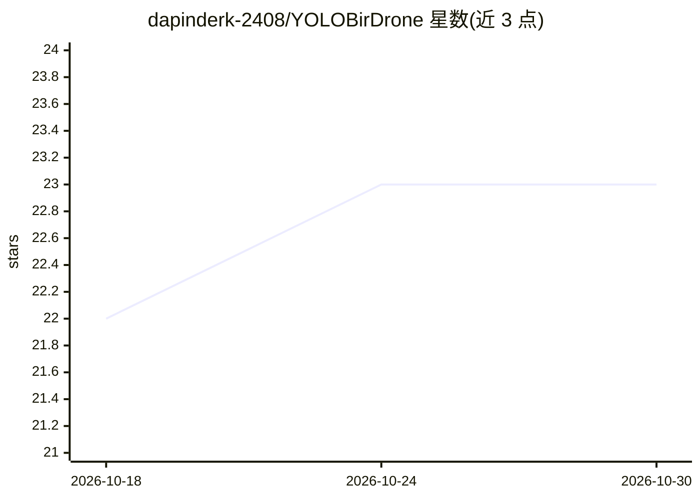

# dapinderk-2408/YOLOBirDrone

⭐ 23 · 推送 2026-10-26 · [GitHub](https://github.com/dapinderk-2408/YOLOBirDrone) · 组织维护

**鸟类 vs 无人机检测数据集与 YOLO 框架论文配套仓库**

配合 arXiv 预印本（2601.08319v1）的仓库：工作包含一个标注的鸟 vs 无人机检测与分类数据集，以及一个基于 YOLO 的增强学习架构，用于应对视觉相似与动态环境等挑战。数据集本身不直接放在仓库中，需通过 Google 表单申请并向 CSIO 邮箱发送邮件获取。README 提供论文链接、引用格式与联系方式。

## 筛选速览

| 维度 | 判定 | 备注 |
|---|---|---|
| AI 角色 | `ai-knowledge` | 知识聚合/清单类 |
| 许可风险 | `none` | — |
| 部署形态 | `None` |  |
| 模型依赖 | — | README 未给出锁定关系 |
| 硬件要求 | — | 无带数字的原话,不猜 |
| 安装摩擦 | `low` | 无编译、无系统依赖或容器化 |
| 成熟度 | — | 结构信号不足 |

## 能力要点

- 标注的鸟 vs 无人机检测与分类数据集
- 配套 YOLO 增强学习架构的 arXiv 预印本
- 数据集按请求方式提供（表单+邮件申请）

## 适用场景

- 为空中目标检测研究申请获取数据集
- 引用该数据集与 YOLO 架构做基准测试
- 查阅鸟 vs 无人机检测的论文工作

## 场景标签

`目标检测` · 领域:感知与多模态

## 证据(README 行号)

> L6: A **labeled dataset for bird vs drone detection and classification** has been developed as part of this work.
> L20: This work introduces a novel dataset and enhanced YOLO-based learning framework for bird vs drone detection and cla

## 星数曲线

2026-10-18 22 → 2026-10-30 23（+1）

---
*卡片 v1 · prompt 1.4 · 生成 2026-10-27 · 置信度 high · 依据 README sha `62f8adecca59` · [字段定义](../../DATASET.md)*
