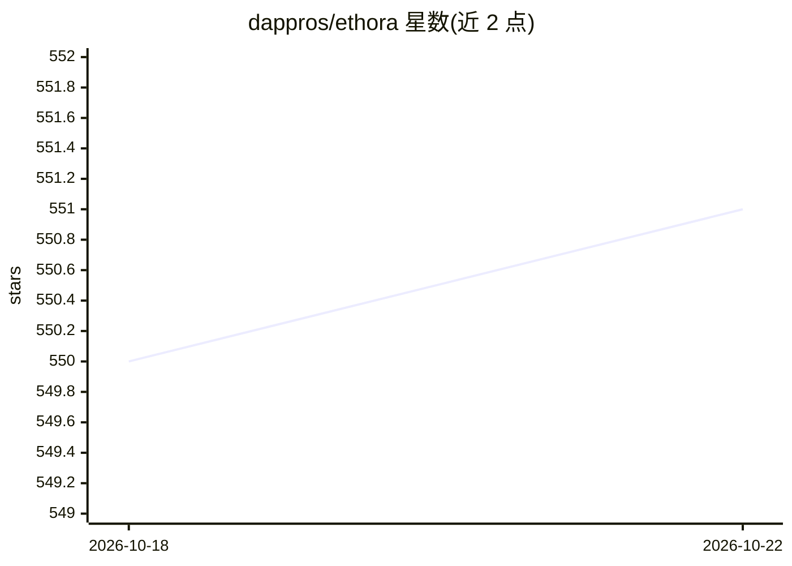

# dappros/ethora

⭐ 551 · JavaScript · Apache-2.0 · 推送 2026-10-22 · [GitHub](https://github.com/dappros/ethora) · [官网](https://ethora.com/) · 组织维护

**面向开发者的聊天/消息与对话式 AI SDK monorepo**

由 Dappros 维护的 Ethora SDK monorepo，聚合 React.js、React Native、Android、iOS、WordPress 等聊天 SDK 及 MCP server、RAG 示例、bot 框架与后端集成示例，以 git 子模块链接各组件仓库。SDK 默认连接 Ethora Cloud 免费云服务，也可自托管（一键脚本、Docker Compose、Helm、AWS Marketplace、Cloudron）。提供 MCP server 供 AI agent 与 IDE 接入平台，并附各 SDK 的功能覆盖矩阵与多层测试体系。许可证为 AGPL 与 MIT（各仓库分别注明），另可从 Dappros 获取商业许可。

## 筛选速览

| 维度 | 判定 | 备注 |
|---|---|---|
| AI 角色 | `ai-ecosystem` | LLM/agent 周边工具 |
| 许可风险 | `permissive` | Apache-2.0 |
| 部署形态 | `self-host` | docker 或自建部署 |
| 模型依赖 | — | README 未给出锁定关系 |
| 硬件要求 | — | 无带数字的原话,不猜 |
| 安装摩擦 | `low` | 无编译、无系统依赖或容器化 |
| 成熟度 | — | 结构信号不足 |

## 能力要点

- 5 个前端/移动端聊天 SDK + WordPress 无代码插件
- 托管 MCP server（HTTP + stdio CLI）供 AI agent 与 IDE 接入
- 自托管服务器：一键脚本、Docker Compose、Helm、AWS Marketplace、Cloudron
- 44 项功能的跨 SDK 覆盖矩阵与四层测试体系

## 适用场景

- 在我的 Web/移动应用中嵌入实时聊天与消息功能
- 部署带 LLM 机器人和 RAG 管道的对话式 AI 应用
- 通过 MCP 让 Claude Code/Cursor 等 AI 客户端操作聊天平台
- 自托管聊天服务器并接入自己的 SDK 配置

## 场景标签

`聊天机器人` `RAG` · 领域:对话与助手

## 证据(README 行号)

> L7: **Chat, messaging and conversational AI SDK platform.** Add real-time messaging, AI bots, and backend services to yo
> L9: This repository serves as the **SDK monorepo** — a single place to discover, clone, and navigate all Ethora SDKs, to
> L23: |`mcp-cli/`|ethora-mcp-server|MCP server for AI agents and IDEs: hosted remote endpoint + stdio CLI|Active|

## 星数曲线

2026-10-18 550 → 2026-10-22 551（+1）

---
*卡片 v1 · prompt 1.4 · 生成 2026-10-21 · 置信度 high · 依据 README sha `f577244fe616` · [字段定义](../../DATASET.md)*
