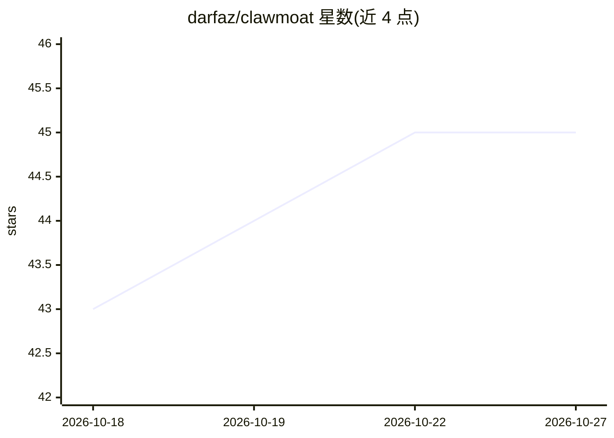

# darfaz/clawmoat

⭐ 45 · JavaScript · MIT · 推送 2026-08-17 · [GitHub](https://github.com/darfaz/clawmoat) · [官网](https://clawmoat.com) · 个人维护

**开源 agent 防火墙：拦截桌面 AI agent 的注入、泄密与危险工具调用**

面向桌面 AI agent 的运行时安全层：在输入、工具调用与输出三个环节扫描文本，检测提示注入、秘密/PII 外泄、危险命令与供应链投毒，并用 YAML 策略引擎管控 shell/文件/浏览器/网络访问，映射 OWASP Agentic AI Top 10。零依赖、纯 Node.js，声称亚毫秒级扫描；自评 40 例攻击 100% 检出、0 误报。提供 LangChain 回调、Express/Fastify 中间件与通用 guard 适配器，附 CLI（MCP 配置扫描、生命周期审计、实时监控面板）。限制：基准为项目自评。

## 筛选速览

| 维度 | 判定 | 备注 |
|---|---|---|
| AI 角色 | `ai-ecosystem` | LLM/agent 周边工具 |
| 许可风险 | `permissive` | MIT |
| 部署形态 | `self-host` | docker 或自建部署 |
| 模型依赖 | — | README 未给出锁定关系 |
| 硬件要求 | — | 无带数字的原话,不猜 |
| 安装摩擦 | `low` | 无编译、无系统依赖或容器化 |
| 成熟度 | — | 结构信号不足 |

## 能力要点

- 输入/工具调用/输出三环节扫描，30+ 凭据模式与 PII 检测
- YAML 策略引擎管控 shell、文件、浏览器与网络访问
- clawmoat scan-mcp 扫描 MCP 配置与危险工具权限
- 生命周期审计检查 agent 身份、审批门、审计轨迹与 kill switch

## 适用场景

- 在本机运行带文件/shell/浏览器权限的 AI agent 前加上安全围栏
- CI/CD 中对 agent 相关变更做安全校验并阻断违规构建
- 扫描 Claude Desktop/Cursor 等工具的 MCP 配置发现危险权限

## 场景标签

`网络安全` · 领域:学习与行业

## 证据(README 行号)

> L5:  ClawMoat is the open-source agent seatbelt: runtime security for desktop AI agents with files, shell, browser, MCP,
> L110: Building with **LangChain**, **CrewAI**, **AutoGen**, or **OpenAI Agents**? Your agents have real capabilities — s
> L124: **Works with any agent framework.** ClawMoat scans text — it doesn't care if it came from LangChain, CrewAI, AutoG

## 星数曲线

2026-10-18 43 → 2026-10-27 45（+2）

---
*卡片 v1 · prompt 1.4 · 生成 2026-10-25 · 置信度 mid · 依据 README sha `a280331602e8` · [字段定义](../../DATASET.md)*
