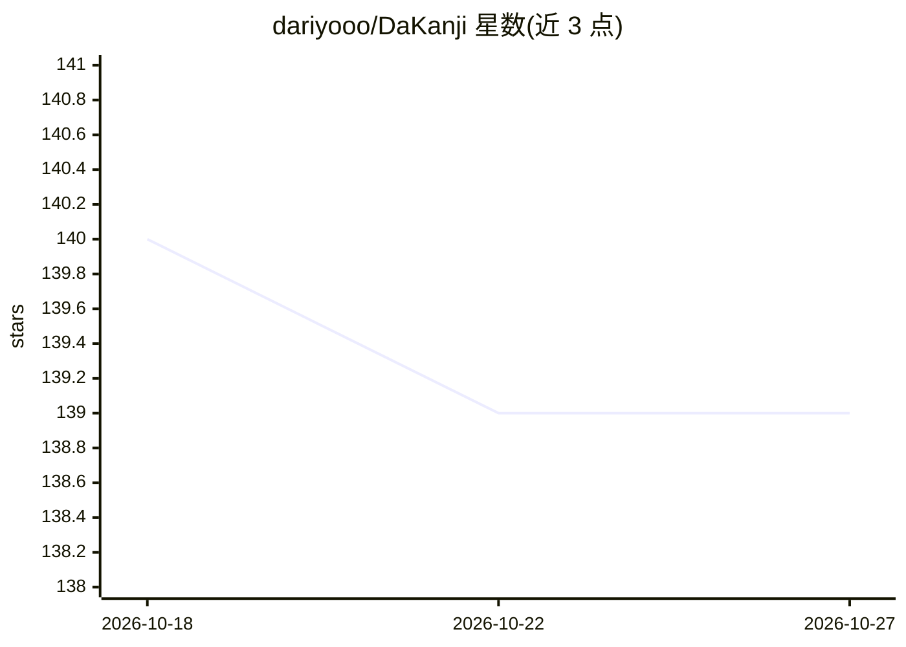

# dariyooo/DaKanji

⭐ 139 · Dart · NOASSERTION · 推送 2026-07-30 · [GitHub](https://github.com/dariyooo/DaKanji) · [官网](https://dakanji.app) · 个人维护

**日语学习者的离线汉字手写识别与词典查词应用**

面向日语学习者的多平台应用：通过手写识别 6500+ 汉字与全部假名（离线运行），内置多语言离线词典（词义、音调、相关词），提供汉字部首/笔画查询、6000+ 读音音频、例句，并可为日文文本添加振假名与空格以辅助阅读。覆盖 Android、iOS、Windows、macOS 与 Linux（Snap）平台，通过各应用商店分发。

## 筛选速览

| 维度 | 判定 | 备注 |
|---|---|---|
| AI 角色 | `ai-native` | 本体是模型或模型工具 |
| 许可风险 | `none` | NOASSERTION |
| 部署形态 | `None` |  |
| 模型依赖 | — | README 未给出锁定关系 |
| 硬件要求 | — | 无带数字的原话,不猜 |
| 安装摩擦 | `low` | 无编译、无系统依赖或容器化 |
| 成熟度 | — | 结构信号不足 |

## 能力要点

- 离线手写识别 6500+ 汉字与全部假名
- 内置多语言离线词典与汉字详情（部首、JLPT 级别等）
- 为文本添加振假名、空格等辅助阅读标注
- 支持 Android、iOS、Windows、macOS、Linux 五平台

## 适用场景

- 手写不认识的汉字快速查词
- 查询单词音调、汉字部首与 JLPT 级别等信息
- 给日文文本加振假名帮助阅读

## 场景标签

`OCR` · 领域:感知与多模态

## 证据(README 行号)

> L30: * Recognize 6500+ Kanji and all Kana offline by just drawing them
> L25: You are learning Japanese? Then you need to try DaKanji!

## 星数曲线

2026-10-18 140 → 2026-10-27 139（-1）

---
*卡片 v1 · prompt 1.4 · 生成 2026-10-22 · 置信度 high · 依据 README sha `b780d2a0e941` · [字段定义](../../DATASET.md)*
