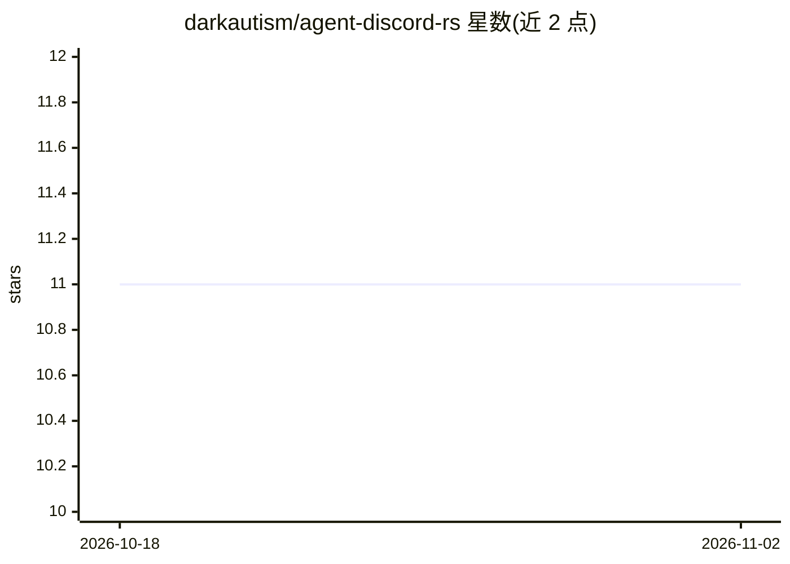

# darkautism/agent-discord-rs

⭐ 11 · Rust · MIT · 推送 2026-03-03 · [GitHub](https://github.com/darkautism/agent-discord-rs) · 个人维护 · 中文 README

**Rust Discord 机器人守护进程，桥接多种编码 agent 后端**

用 Rust 编写的 Discord bot 守护进程，将 Pi（RPC）、OpenCode、Kilo、Copilot 等编码 agent 后端统一到一个频道工作流中。提供多后端路由、按频道配置、文件上传管道（本地暂存+TTL 清理）、流式 UI（thinking/工具状态+增量渲染）、会话生命周期控制（切换模型/思考级别/压缩/中止）、定时任务与 zh-TW/en 双语界面。需 Rust 工具链、Discord bot token 及至少一个后端 CLI；通过 cargo 安装，支持 systemd 守护运行。

## 筛选速览

| 维度 | 判定 | 备注 |
|---|---|---|
| AI 角色 | `ai-ecosystem` | LLM/agent 周边工具 |
| 许可风险 | `permissive` | MIT |
| 部署形态 | `library` | 以包/库形式分发 |
| 模型依赖 | — | README 未给出锁定关系 |
| 硬件要求 | — | 无带数字的原话,不猜 |
| 安装摩擦 | `low` | 无编译、无系统依赖或容器化 |
| 成熟度 | — | 结构信号不足 |

## 能力要点

- 多后端路由：Pi（RPC）、OpenCode、Kilo、Copilot
- 文件附件本地暂存、传后端处理并按 TTL 自动清理
- 会话控制：模型切换、思考级别、compact/clear/abort
- zh-TW 与 en 双语 UI

## 适用场景

- 在 Discord 频道中调用编码 agent 处理任务
- 按频道切换不同 agent 后端与模型
- 通过 cron 定时提示词做周期性任务

## 场景标签

`编码 Agent` · 领域:编码与开发

## 证据(README 行号)

> L5: A high-performance Discord bot daemon in Rust that bridges multiple coding-agent backends with a unified channel wor
> L16: - Multi-backend routing: Pi (RPC), OpenCode, Kilo, and Copilot.

## 星数曲线

2026-10-18 11 → 2026-11-02 11（+0）

---
*卡片 v1 · prompt 1.4 · 生成 2026-11-02 · 置信度 mid · 依据 README sha `eff0765a996b` · [字段定义](../../DATASET.md)*
