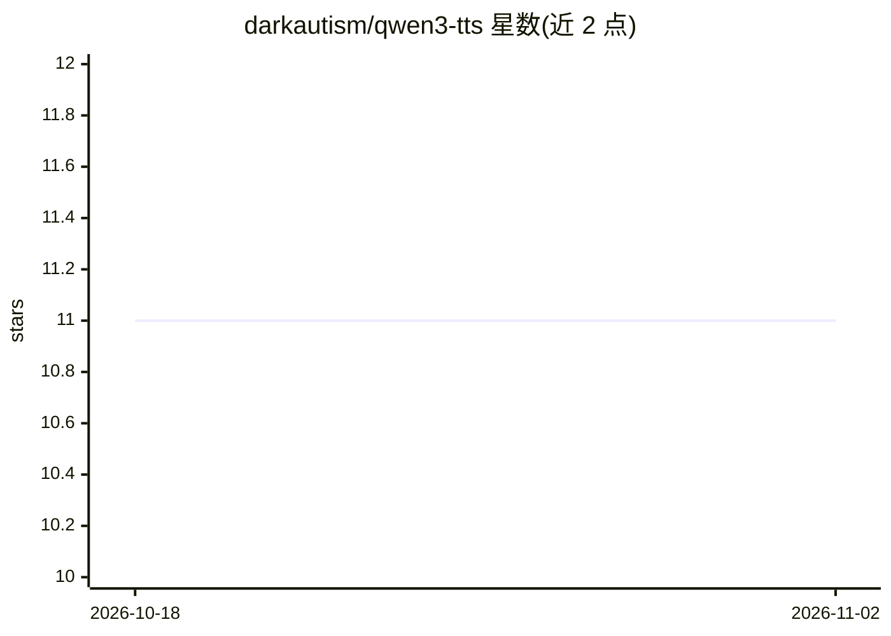

# darkautism/qwen3-tts

⭐ 11 · Rust · 推送 2026-03-06 · [GitHub](https://github.com/darkautism/qwen3-tts) · 个人维护 · 中文 README

**面向低成本 SBC 集群的分布式 Qwen3-TTS 语音合成系统**

Rust 实现的 Qwen3-TTS 分布式推理系统：将文本转语音流水线拆分为 Talker（分词+嵌入+LLM）、Predictor（GGUF/ONNX 声码预测）、Vocoder（ONNX）三种 worker 角色，部署在 1-3 台 Linux 机器（支持 aarch64/x86_64，测试于 RK3588）上运行，单二进制同时提供 CLI、OpenAI 兼容 HTTP API、内置 Web UI 与 MCP stdio 桥。推理核心用 Candle 纯 Rust 实现，模型从 HuggingFace Hub 自动下载，支持语音克隆（Mimi Speech Tokenizer 编码参考音频）。默认 GGUF 路径约 5.5 tok/s，可选 GGML/RKNN NPU 加速特性。

## 筛选速览

| 维度 | 判定 | 备注 |
|---|---|---|
| AI 角色 | `ai-native` | 本体是模型或模型工具 |
| 许可风险 | `none` | — |
| 部署形态 | `library` | 以包/库形式分发 |
| 模型依赖 | local-ok | 支持本地模型 |
| 硬件要求 | — | 无带数字的原话,不猜 |
| 安装摩擦 | `high` | 编译与系统依赖俱全 |
| 成熟度 | — | 结构信号不足 |

## 能力要点

- 三种 worker 角色分布式部署，单二进制含 CLI/OpenAI 兼容 API/Web UI/MCP 桥
- Candle 纯 Rust 推理核心，无需外部 C/C++ 库（默认路径）
- 语音克隆：参考音频编码为 .json 声音文件，ARM 上原生运行
- 500+ HuggingFace 声音在内置 Web UI 中可选，支持中英日韩

## 适用场景

- 在多台低成本 ARM 开发板上搭建分布式 TTS 服务
- 通过 OpenAI 兼容 API 为现有应用提供语音合成接口
- 用参考音频克隆特定音色进行配音生成

## 场景标签

`语音合成` `推理引擎` · 领域:内容生成

## 证据(README 行号)

> L5: Distributed Qwen3-TTS — Rust-based distributed text-to-speech optimized for low-cost SBC clusters.
> L9: Single binary provides CLI, an OpenAI-compatible HTTP API (with web UI), an MCP stdio bridge, and inference workers.
> L55: |**Talker**|Tokenizer + TextEmbedder + LLM|CPU|9090|
> L59: Distributes workload across low-cost SBCs or any Linux machines. Token generation: ~5.5 tok/s with stripped code-pr

## 星数曲线

2026-10-18 11 → 2026-11-02 11（+0）

---
*卡片 v1 · prompt 1.4 · 生成 2026-11-02 · 置信度 mid · 依据 README sha `22d820857799` · [字段定义](../../DATASET.md)*
