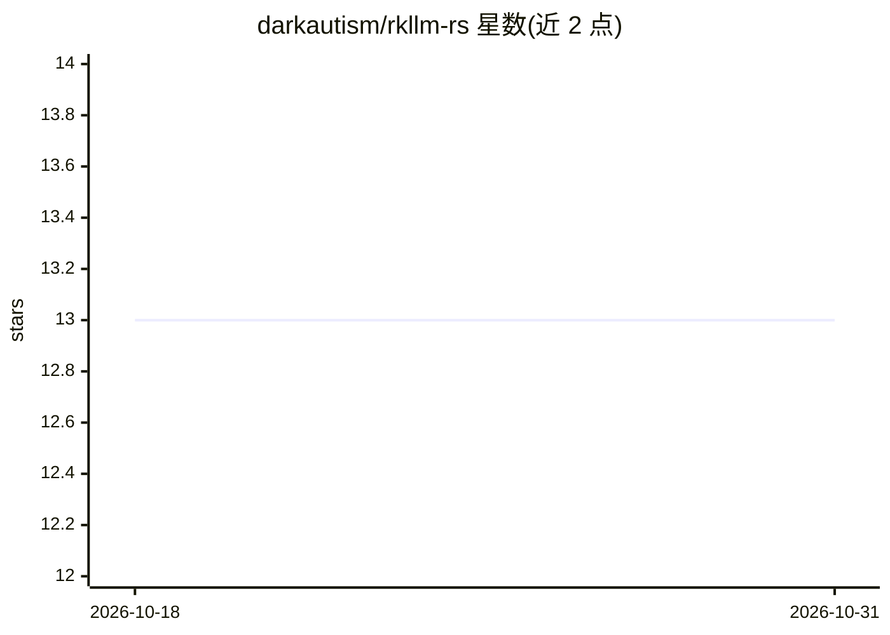

# darkautism/rkllm-rs

⭐ 13 · Rust · NOASSERTION · 推送 2026-10-19 · [GitHub](https://github.com/darkautism/rkllm-rs) · [官网](https://github.com/darkautism/rkllm-rs) · 个人维护

**RKLLM Runtime 的 Rust FFI 绑定：在 RK3588 上运行本地 LLM**

对 airockchip/rknn-llm 的 librkllmrt 库做 Rust FFI 封装，用于在 RK3588 等 NPU 设备上运行 RKLLM 格式模型。提供两层 API：raw FFI 与免 C 指针的安全封装（Drop 自动清理资源）。支持以 cargo 库方式集成，也可安装为二进制开箱即用地运行 .rkllm 模型，功能包括 function calling、多模态 cross-attention 参数（实验性）与在线拉取 tokenizer_config.json 修正提示词。需自行下载安装 librkllmrt.so；模型类型目前硬编码，未支持模型需在线配置修正。main 分支跟踪上游 release-v1.3.0。

## 筛选速览

| 维度 | 判定 | 备注 |
|---|---|---|
| AI 角色 | `ai-ecosystem` | LLM/agent 周边工具 |
| 许可风险 | `none` | NOASSERTION |
| 部署形态 | `library` | 以包/库形式分发 |
| 模型依赖 | — | README 未给出锁定关系 |
| 硬件要求 | — | 无带数字的原话,不猜 |
| 安装摩擦 | `low` | 无编译、无系统依赖或容器化 |
| 成熟度 | — | 结构信号不足 |

## 能力要点

- Rust-first 安全封装 API，Drop 自动释放资源
- 支持以二进制方式 cargo install 后直接运行 .rkllm 模型
- function calling：以 serde 序列化的 Rust 结构体定义工具
- 在线获取 tokenizer_config.json 生成正确提示词；cross-attention 多模态支持（实验性）

## 适用场景

- 在 RK3588 开发板上用 Rust 集成本地 LLM 推理
- 不想开发、直接命令行运行 DeepSeek/TinyLlama 等 RKLLM 模型
- 给嵌入式 LLM 应用接 function calling 工具调用

## 场景标签

`推理引擎` · 领域:训练与推理

## 证据(README 行号)

> L5: `rkllm-rs` is a Rust FFI wrapper for the `librkllmrt` library.
> L105: `rkllm-rs` also supports running as a binary, suitable for users who do not plan to do further development or pref

## 星数曲线

2026-10-18 13 → 2026-10-31 13（+0）

---
*卡片 v1 · prompt 1.4 · 生成 2026-10-31 · 置信度 high · 依据 README sha `69565f39901d` · [字段定义](../../DATASET.md)*
