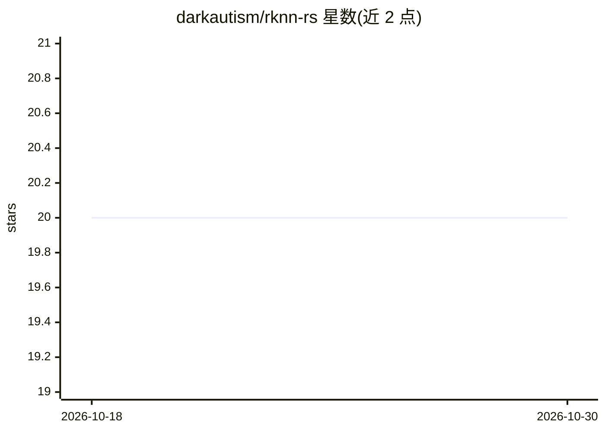

# darkautism/rknn-rs

⭐ 20 · C · 推送 2026-02-26 · [GitHub](https://github.com/darkautism/rknn-rs) · [官网](https://github.com/darkautism/rknn-rs) · 个人维护

**RKNN C API 的 Rust 安全封装，用于 Rockchip NPU 开发**

将 Rockchip RKNN 的 C API 封装为安全 Rust 结构体与方法的 FFI 绑定库，提供资源释放机制以防止内存泄漏。兼容 RKNN Toolkit 2.3.2，通过 Cargo.toml 添加 rknnmrt feature gate 启用 rknnmrt 支持。附有一个使用 Rust 运行 SenseVoice Small RKNN 模型的示例项目。MIT 许可，接受捐赠赞助维护。

## 筛选速览

| 维度 | 判定 | 备注 |
|---|---|---|
| AI 角色 | `ai-ecosystem` | LLM/agent 周边工具 |
| 许可风险 | `none` | — |
| 部署形态 | `None` |  |
| 模型依赖 | — | README 未给出锁定关系 |
| 硬件要求 | — | 无带数字的原话,不猜 |
| 安装摩擦 | `low` | 无编译、无系统依赖或容器化 |
| 成熟度 | — | 结构信号不足 |

## 能力要点

- 将 rknn_api C 接口封装为安全 Rust API
- 实现资源释放机制防止内存泄漏
- 通过 feature gate 支持 rknnmrt

## 适用场景

- 在 Rust 嵌入式项目中调用 RKNN 运行 NPU 推理
- 在 RK3588 等 Rockchip 平台上部署 RKNN 模型

## 场景标签

`推理引擎` · 领域:训练与推理

## 证据(README 行号)

> L1: # RKNN for rust dependency status
> L5:  * **Rusty API**: Encapsulates the C-based `rknn_api` into safe Rust structs and methods.

## 星数曲线

2026-10-18 20 → 2026-10-30 20（+0）

---
*卡片 v1 · prompt 1.4 · 生成 2026-10-28 · 置信度 high · 依据 README sha `e39b0ff02a3f` · [字段定义](../../DATASET.md)*
