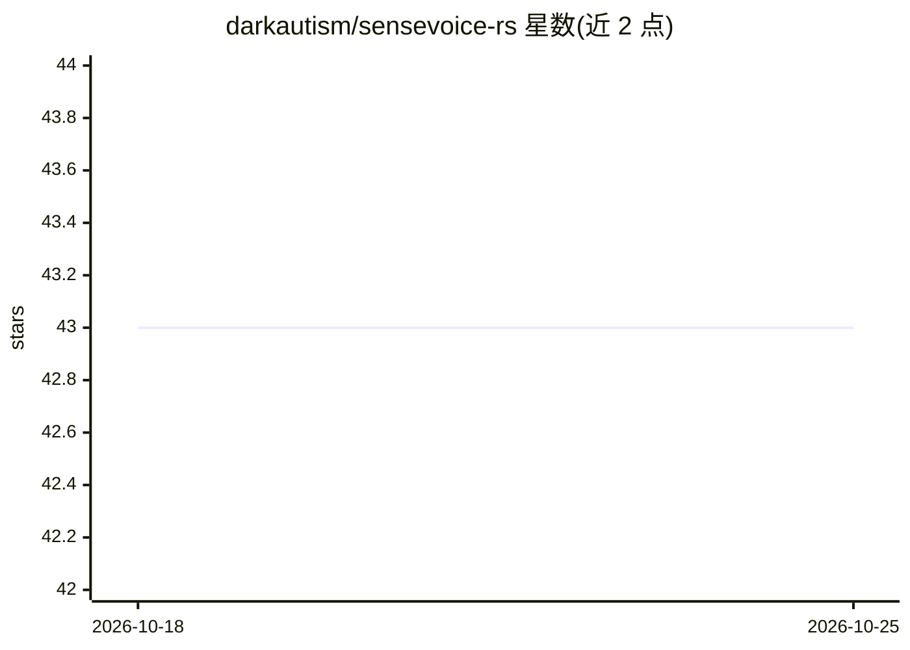

# darkautism/sensevoice-rs

⭐ 43 · Rust · 推送 2026-09-28 · [GitHub](https://github.com/darkautism/sensevoice-rs) · 个人维护

**纯 Rust 语音识别库，支持 Rockchip NPU 运行 SenseVoiceSmall**

以 Rust 实现的 SenseVoiceSmall 语音识别库，供嵌入式与桌面开发者集成。提供两条运行路径：纯 Rust 路径基于 Candle 加载官方 model.pt（含 FSMN-VAD，VAD 模型由 hf-hub 自动下载）；RKNN 路径在 Rockchip NPU 上运行，需先安装 rknn 运行时库并启用 rknpu feature gate。不依赖外部 ONNX Runtime。API 支持处理音频文件或音频流，输出语言、情绪、事件与转写内容。

## 筛选速览

| 维度 | 判定 | 备注 |
|---|---|---|
| AI 角色 | `ai-native` | 本体是模型或模型工具 |
| 许可风险 | `none` | — |
| 部署形态 | `None` |  |
| 模型依赖 | — | README 未给出锁定关系 |
| 硬件要求 | — | 无带数字的原话,不猜 |
| 安装摩擦 | `low` | 无编译、无系统依赖或容器化 |
| 成熟度 | — | 结构信号不足 |

## 能力要点

- 纯 Rust ASR 路径：Candle 原生加载官方 model.pt
- Rockchip NPU 路径：RKNN + rknpu 后端
- VAD 默认走官方 FSMN-VAD，模型经 hf-hub 自动下载
- 无需外部 ONNX Runtime（ort）

## 适用场景

- 在 RK3588 等 Rockchip 设备上做本地离线语音转写
- Rust 项目中集成 SenseVoiceSmall 语音识别能力
- 处理音频文件或流式音频的语音转文字

## 场景标签

`语音识别` · 领域:感知与多模态

## 证据(README 行号)

> L5: A Pure Rust speech recognition library, using Candle for the non-RKNN runtime and RKNN for Rockchip NPU runtime.
> L26: - Pure Rust ASR path: Candle + official `model.pt` (native PT loading).

## 星数曲线

2026-10-18 43 → 2026-10-25 43（+0）

---
*卡片 v1 · prompt 1.4 · 生成 2026-10-25 · 置信度 high · 依据 README sha `639de7601962` · [字段定义](../../DATASET.md)*
