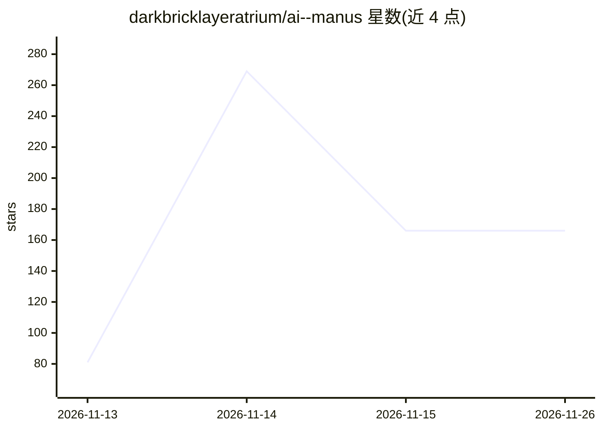

# darkbricklayeratrium/ai--manus

⭐ 166 · Apache-2.0 · 推送 2026-11-15 · [GitHub](https://github.com/darkbricklayeratrium/ai--manus) · 个人维护

**自主 AI Agent：代用户执行代码与操控浏览器完成任务**

README 描述 Manus 为自主 AI 代理，可在最少监督下编写并执行脚本、打开网页、与页面元素交互、执行多步任务，定位面向家庭、学习与轻量办公场景，而非企业平台。文档包含硬件兼容表（最低双核 CPU / 4GB 内存）与上手步骤，但未给出具体安装命令、依赖或技术架构说明；'Download Manus / PROMO2026' 处指向下载但正文无链接细节。整体为功能介绍型文档。

## 筛选速览

| 维度 | 判定 | 备注 |
|---|---|---|
| AI 角色 | `ai-native` | 本体是模型或模型工具 |
| 许可风险 | `permissive` | Apache-2.0 |
| 部署形态 | `None` |  |
| 模型依赖 | — | README 未给出锁定关系 |
| 硬件要求 | — | 无带数字的原话,不猜 |
| 安装摩擦 | `low` | 无编译、无系统依赖或容器化 |
| 成熟度 | — | 结构信号不足 |

## 能力要点

- 自主编写并执行代码完成多步任务
- 浏览器控制：导航网页、填写表单、采集信息
- 代码执行与浏览器操作可在同一工作流中衔接
- 跨会话记忆并复用相同工作流模式

## 适用场景

- 让代理代为完成重复性的网页操作与脚本执行
- 学生学习研究中整理笔记、运行小脚本
- 远程办公时从多个页面收集信息

## 场景标签

`工作流自动化` `浏览器自动化` `编码 Agent` · 领域:效率与自动化

## 证据(README 行号)

> L10: - **Autonomous Code Execution:** Manus AI agent runs code on its own to complete tasks, so you can focus on decisio
> L18: Manus is an autonomous AI agent designed to run code and control a browser on your behalf. Instead of acting like a

## 星数曲线

2026-11-13 81 → 2026-11-26 166（+85）

---
*卡片 v1 · prompt 1.4 · 生成 2026-11-17 · 置信度 low · 依据 README sha `a3d88e202bf0` · [字段定义](../../DATASET.md)*
