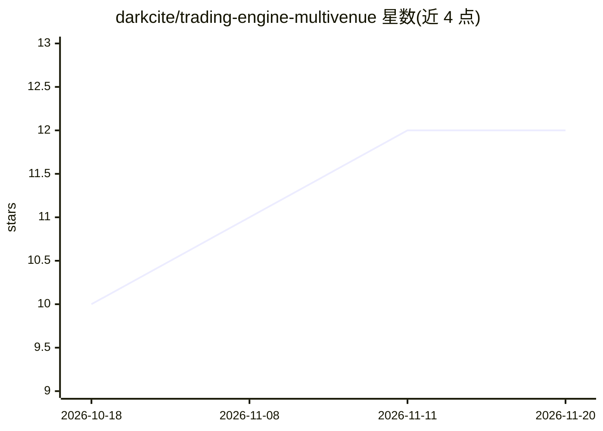

# darkcite/trading-engine-multivenue

⭐ 12 · Rust · Apache-2.0 · 推送 2026-11-12 · [GitHub](https://github.com/darkcite/trading-engine-multivenue) · 个人维护

**面向量化交易者的多交易所 Rust HFT 回测与执行引擎**

纯 Rust 实现的低延迟交易引擎，支持在 Binance 现货/USDM、OKX、Deribit、Hyperliquid、Bybit、MEXC（仅行情）与 Polymarket CLOB 上执行系统化策略；策略由槽位集在启动时组合，包括 AI 执行意图、ruleset VM 与 intrabar K 线成员。每个 ingress 线程写入 PMLR 回放捕获，提供回测、P&L 审计与逐交易所延迟校准流程。Python 侧的 claude-worker 作为离线策略研究员，经 HMAC'd UDS 命令通道与引擎通信，不进入热路径。可在 MacBook Pro M4 本地运行，不依赖云服务。

## 筛选速览

| 维度 | 判定 | 备注 |
|---|---|---|
| AI 角色 | `ai-enhanced` | 去掉 AI 部分产品仍成立 |
| 许可风险 | `permissive` | Apache-2.0 |
| 部署形态 | `library` | 以包/库形式分发 |
| 模型依赖 | locked-api |  |
| 硬件要求 | — | 无带数字的原话,不猜 |
| 安装摩擦 | `low` | 无编译、无系统依赖或容器化 |
| 成熟度 | — | 结构信号不足 |

## 能力要点

- 跨 7 个交易所场所的纯 Rust 零分配 HFT 引擎，热路径 0 B/op 断言
- 每 run 生成 PMLR 回放捕获与 instrument 清单，回测可重判 stale tick
- claude-worker 离线提出/回测/暂存 ruleset，经 HMAC'd UDS 下发
- 强制逐部署位置的 venue 延迟实测流程（latency_probe）

## 适用场景

- 对多交易所行情做带 PMLR 回放的量化回测研究
- 在 Hyperliquid 永续上运行 post-only 做市策略（paper）
- 以 testnet 优先流程灰度上线实盘执行槽位
- 让 AI 研究员离线生成并筛选交易规则集

## 场景标签

`金融量化` · 领域:学习与行业

## 证据(README 行号)

> L12: Strategies are composed at boot from a slot set (AI-executed intents, the
> L23: Claude (via the `claude-worker` Python process) is an **offline strategy

## 星数曲线

2026-10-18 10 → 2026-11-20 12（+2）

---
*卡片 v1 · prompt 1.4 · 生成 2026-11-18 · 置信度 low · 依据 README sha `8a8f10bd50ff` · [字段定义](../../DATASET.md)*
