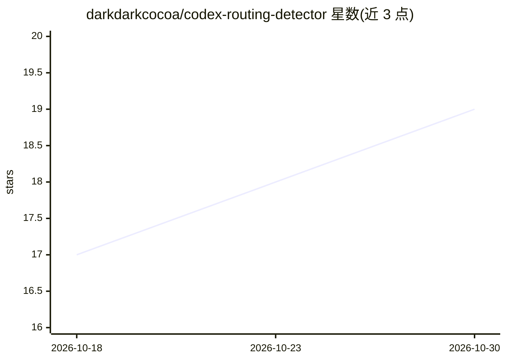

# darkdarkcocoa/codex-routing-detector

⭐ 19 · Python · MIT · 推送 2026-10-27 · [GitHub](https://github.com/darkdarkcocoa/codex-routing-detector) · [官网](https://github.com/darkdarkcocoa/codex-routing-detector/releases/latest) · 个人维护

**检测 Codex 请求是否被静默替换为其他模型的核查工具**

面向 Codex CLI / Desktop 用户的桌面与命令行工具：通过读取服务器响应中写入的 model 字段，判断所请求的模型（如 gpt-6-astra）是否实际由另一模型（如 gpt-5.6-luna）应答，输出 REROUTED/ok/UNSUPPORTED/ERROR 等判定。提供单次 Check 探测（约 30 秒、含对照组模型）与 Live monitor 实时监控本机 Codex CLI 会话两种模式；支持重复探测、JSON 报告与 mitmproxy 抓包模式。Windows 提供 exe，也可经 pipx 安装；实时监控仅在 Windows 完整测试，且无法监控 Codex Desktop 应用。

## 筛选速览

| 维度 | 判定 | 备注 |
|---|---|---|
| AI 角色 | `ai-ecosystem` | LLM/agent 周边工具 |
| 许可风险 | `permissive` | MIT |
| 部署形态 | `desktop` | 安装包/桌面程序 |
| 模型依赖 | — | README 未给出锁定关系 |
| 硬件要求 | — | 无带数字的原话,不猜 |
| 安装摩擦 | `low` | 无编译、无系统依赖或容器化 |
| 成熟度 | — | 结构信号不足 |

## 能力要点

- 读取服务器响应中的 model 字段判定请求模型与实际应答模型是否一致
- Check 单次探测（含 control 对照模型）与 Live monitor 实时会话监控两种模式
- Windows exe 免 Python 运行，亦支持 pipx 安装与命令行 --json 输出
- 可选 mitmproxy wire 模式记录包级证据

## 适用场景

- 怀疑订阅的 Codex 模型被静默降级/替换时进行核查
- 工作期间实时监控 Codex CLI 会话的模型路由情况
- 保存 response id 与 JSON 报告用于向社区或官方报告替换现象

## 场景标签

`LLM 可观测性` · 领域:评测与运维

## 证据(README 行号)

> L13: astra really the one answering? This little app asks the **server** and tells you, in one
> L32: model you *asked for*. This app reads the model name the server writes into its response, which
> L73: The second tab watches a real Codex CLI session instead of sending a probe. Press **Start

## 星数曲线

2026-10-18 17 → 2026-10-30 19（+2）

---
*卡片 v1 · prompt 1.4 · 生成 2026-10-29 · 置信度 mid · 依据 README sha `728f17f1dd19` · [字段定义](../../DATASET.md)*
