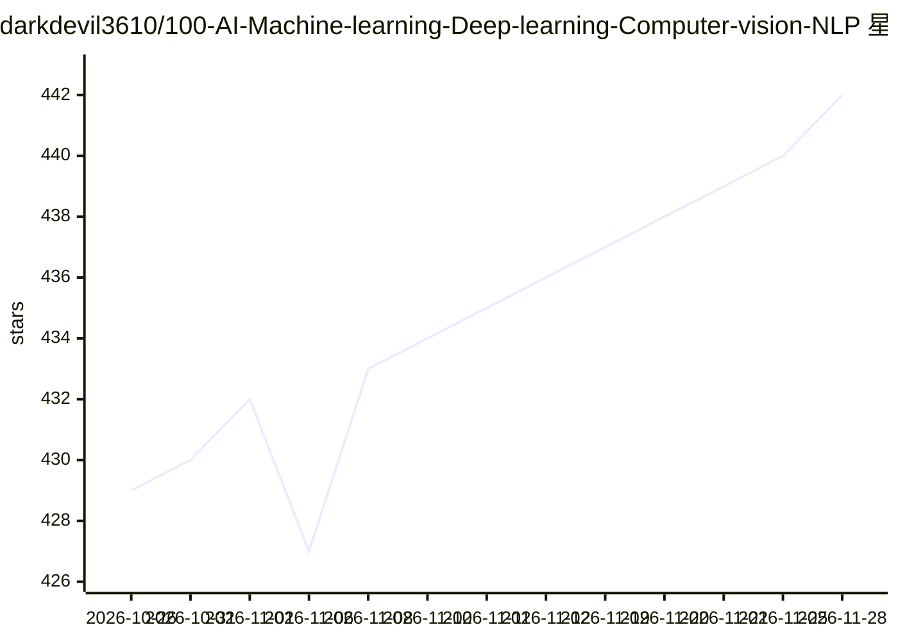

# darkdevil3610/100-AI-Machine-learning-Deep-learning-Computer-vision-NLP

⭐ 442 · 推送 2026-11-27 · [GitHub](https://github.com/darkdevil3610/100-AI-Machine-learning-Deep-learning-Computer-vision-NLP) · [官网](http://gourav.is-a.dev/100-AI-Machine-learning-Deep-learning-Computer-vision-NLP/) · 个人维护

**面向学生的 AI/ML/DL/CV/NLP 项目代码链接清单（200+ 条）**

以表格形式收录 218 条项目、课程与资源链接，按机器学习、深度学习、计算机视觉、NLP、数据科学等主题组织，每条附名称与外链；主题标签包含 final-year-project 与 collageproject，目标读者为完成课程或毕业设计的学习者。清单声明持续更新并接受 pull request 贡献。README 本身不含安装步骤与运行说明，链接均为指向外部仓库的指针。

## 筛选速览

| 维度 | 判定 | 备注 |
|---|---|---|
| AI 角色 | `ai-knowledge` | 知识聚合/清单类 |
| 许可风险 | `none` | — |
| 部署形态 | `None` |  |
| 模型依赖 | — | README 未给出锁定关系 |
| 硬件要求 | — | 无带数字的原话,不猜 |
| 安装摩擦 | `low` | 无编译、无系统依赖或容器化 |
| 成熟度 | — | 结构信号不足 |

## 能力要点

- 收录 218 条带代码的项目/资源链接，含课程笔记与数据集集合
- 覆盖传统 ML、CNN/RNN/Transformer、目标检测、LLM 与 RAG 等主题
- 声明持续更新并开放 PR 贡献

## 适用场景

- 为毕业设计或课程项目找现成的 AI 项目代码
- 按主题浏览 NLP/CV/深度学习的练手项目清单
- 查找机器学习课程与数据集资源入口

## 场景标签

`精选清单` · 领域:学习与行业

## 证据(README 行号)

> L21: |Sr No|Name|Link|
> L23: |1|365 Days Computer Vision Learning|👆|

## 星数曲线

2026-10-26 429 → 2026-11-28 442（+13）

---
*卡片 v1 · prompt 1.4 · 生成 2026-11-28 · 置信度 high · 依据 README sha `7f5627823152` · [字段定义](../../DATASET.md)*
