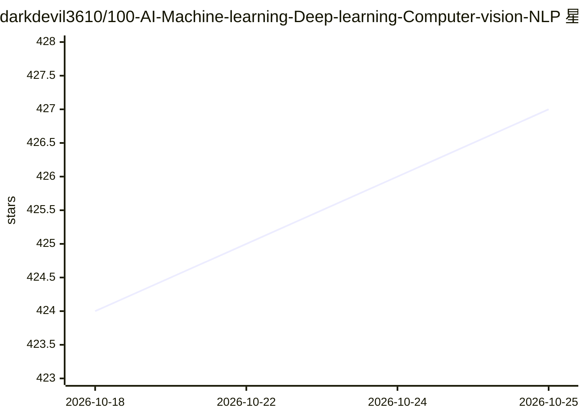

# darkdevil3610/100-AI-Machine-learning-Deep-learning-Computer-vision-NLP

⭐ 429 · 推送 2026-10-21 · [GitHub](https://github.com/darkdevil3610/100-AI-Machine-learning-Deep-learning-Computer-vision-NLP) · [官网](http://gourav.is-a.dev/100-AI-Machine-learning-Deep-learning-Computer-vision-NLP/) · 个人维护

**AI/ML/DL/CV/NLP 项目链接合集（100+ 条目）**

个人维护的 AI 项目资源清单仓库：以编号表格形式收录 200+ 条指向外部 GitHub 仓库或教程的链接条目，覆盖机器学习、深度学习、计算机视觉、NLP、LLM/RAG 应用等方向，另含数据集、论文与代码（Papers with Code 类）和学习资料。README 自述持续更新并接受 PR 贡献，声明所有链接经过测试。本体不含代码实现，仅提供链接导航。

## 筛选速览

| 维度 | 判定 | 备注 |
|---|---|---|
| AI 角色 | `ai-knowledge` | 知识聚合/清单类 |
| 许可风险 | `none` | — |
| 部署形态 | `None` |  |
| 模型依赖 | — | README 未给出锁定关系 |
| 硬件要求 | — | 无带数字的原话,不猜 |
| 安装摩擦 | `low` | 无编译、无系统依赖或容器化 |
| 成熟度 | — | 结构信号不足 |

## 能力要点

- 表格化收录 200+ 条外部项目/资源链接条目
- 覆盖 ML/DL/CV/NLP/LLM/RAG 多个方向
- 含数据集、论文与代码类资源条目
- 声明持续更新并接受社区 PR 贡献

## 适用场景

- 按方向查找带代码的 AI 项目灵感
- 为毕业设计或课程项目寻找参考实现
- 浏览 AI 学习资料与论文集合入口

## 场景标签

`精选清单` `教程课程` · 领域:学习与行业

## 证据(README 行号)

> L1: ***100 + AI Machine learning Deep learning Computer vision NLP Projects with code* !!!**
> L21: |Sr No|Name|Link|

## 星数曲线

2026-10-18 424 → 2026-10-25 427（+3）

---
*卡片 v1 · prompt 1.4 · 生成 2026-10-21 · 置信度 high · 依据 README sha `f92300a07042` · [字段定义](../../DATASET.md)*
