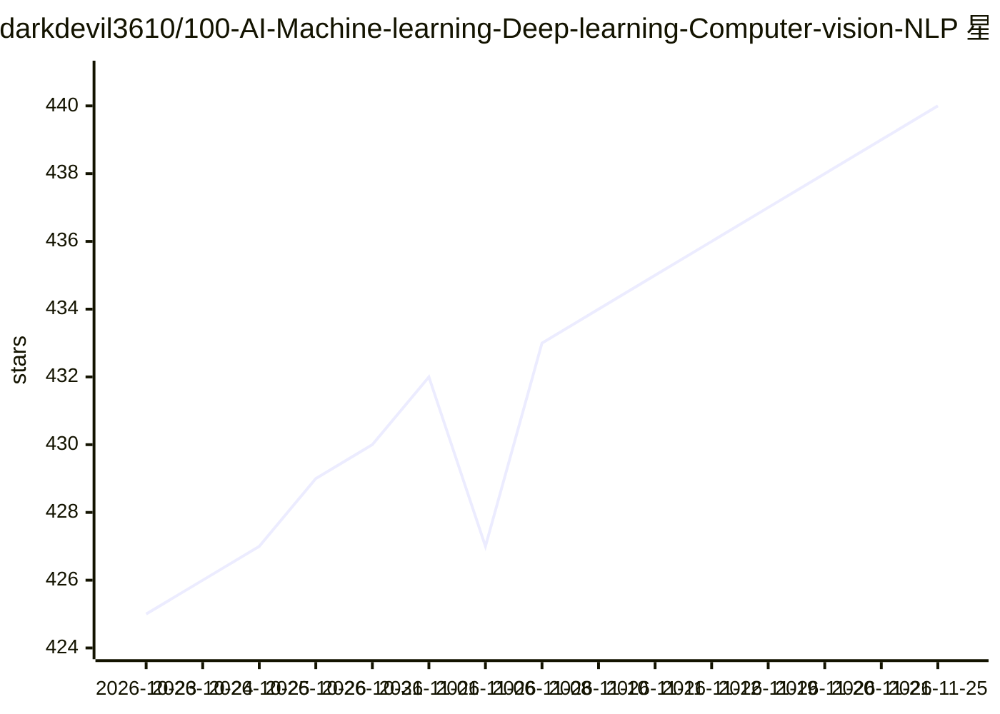

# darkdevil3610/100-AI-Machine-learning-Deep-learning-Computer-vision-NLP

⭐ 440 · 推送 2026-11-22 · [GitHub](https://github.com/darkdevil3610/100-AI-Machine-learning-Deep-learning-Computer-vision-NLP) · [官网](http://gourav.is-a.dev/100-AI-Machine-learning-Deep-learning-Computer-vision-NLP/) · 个人维护

**面向学生与初学者的 AI/ML/DL/CV/NLP 项目合集清单**

一个聚合型清单仓库，收录 200+ 条 AI、机器学习、深度学习、计算机视觉与 NLP 相关项目、教程、数据集与代码合集的链接，以编号表格形式组织，涵盖传统算法、CNN/RNN/Transformer、目标检测、情感分析、LLM 集成、RAG 应用等方向，并包含大量带源码的实践项目条目。仓库声明持续更新并接受 pull request 贡献。本身不含安装或运行说明，仅为外部资源链接的目录。

## 筛选速览

| 维度 | 判定 | 备注 |
|---|---|---|
| AI 角色 | `ai-knowledge` | 知识聚合/清单类 |
| 许可风险 | `none` | — |
| 部署形态 | `None` |  |
| 模型依赖 | — | README 未给出锁定关系 |
| 硬件要求 | — | 无带数字的原话,不猜 |
| 安装摩擦 | `low` | 无编译、无系统依赖或容器化 |
| 成熟度 | — | 结构信号不足 |

## 能力要点

- 200+ 条项目/资源链接以编号表格组织
- 覆盖 ML、DL、CV、NLP、LLM/RAG 等多个方向
- 声明持续更新并接受社区贡献
- 部分条目为带源码的实践项目（如聊天机器人、疾病预测、人脸识别考勤）

## 适用场景

- 为课程设计或毕业设计寻找带代码的项目选题
- 按方向浏览机器学习、计算机视觉、NLP 的学习资源
- 查找特定主题（如目标检测、情感分析）的示例项目

## 场景标签

`精选清单` · 领域:学习与行业

## 证据(README 行号)

> L1: ***100 + AI Machine learning Deep learning Computer vision NLP Projects with code* !!!**
> L21: |Sr No|Name|Link|

## 星数曲线

2026-10-23 425 → 2026-11-25 440（+15）

---
*卡片 v1 · prompt 1.4 · 生成 2026-11-25 · 置信度 high · 依据 README sha `cf726139d9a9` · [字段定义](../../DATASET.md)*
