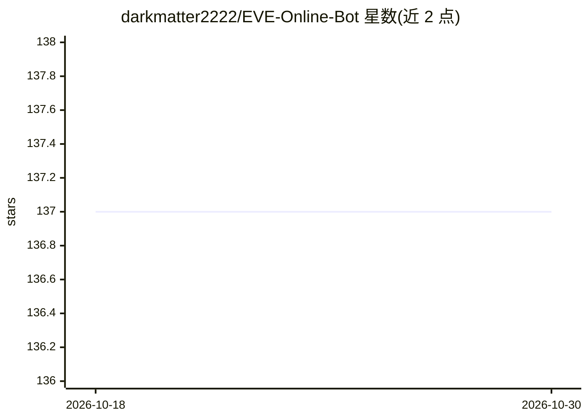

# darkmatter2222/EVE-Online-Bot

⭐ 137 · Jupyter Notebook · MIT · 推送 2026-09-13 · [GitHub](https://github.com/darkmatter2222/EVE-Online-Bot) · 个人维护

**用机器学习玩 EVE Online 的游戏机器人（挖矿/导航自动化）**

面向 EVE Online 玩家的自动化机器人：以 TensorFlow 模型识别游戏状态（机库/飞行中/断线/选角界面）与右键菜单内容，结合 Tesseract OCR 与像素密度检测读取界面信息，通过接管鼠标键盘实现自动挖矿（自动卸货、矿场枯竭检测、断线重连）与航点导航等目标。支持一键启动并自管游戏启动器与登录流程。需 Python 3.9 环境、1920x1080 显示器与 125% UI 缩放，README 声明仅供教育用途。

## 筛选速览

| 维度 | 判定 | 备注 |
|---|---|---|
| AI 角色 | `ai-native` | 本体是模型或模型工具 |
| 许可风险 | `permissive` | MIT |
| 部署形态 | `desktop` | 安装包/桌面程序 |
| 模型依赖 | — | README 未给出锁定关系 |
| 硬件要求 | `cpu-ok` | |
| 安装摩擦 | `low` | 无编译、无系统依赖或容器化 |
| 成熟度 | — | 结构信号不足 |

## 能力要点

- ML 模型识别游戏状态与上下文菜单
- Tesseract OCR 与像素密度检测读取游戏界面
- 自动挖矿目标：自动卸货、矿场枯竭检测、服务器重启后自动重连
- 自管启动器与登录流程的一键启动

## 适用场景

- 挂机自动挖矿并自动卸货回站
- 设置航点链后自动高速导航
- 自动运行 Project Discovery 玩法

## 场景标签

`GUI 自动化` · 领域:效率与自动化

## 证据(README 行号)

> L27: **ML Component:**
> L39: Whats the magic here? Leveraging ML to understand the content menus and select the right options.

## 星数曲线

2026-10-18 137 → 2026-10-30 137（+0）

---
*卡片 v1 · prompt 1.4 · 生成 2026-10-22 · 置信度 high · 依据 README sha `4e07d72a42dc` · [字段定义](../../DATASET.md)*
