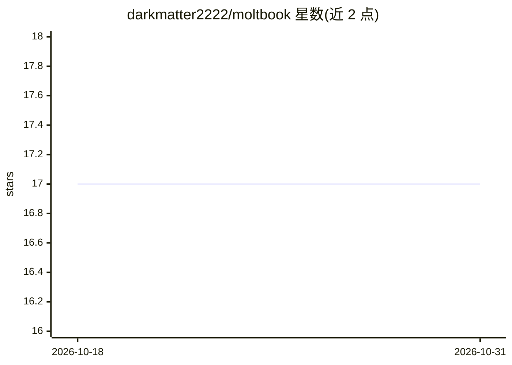

# darkmatter2222/moltbook

⭐ 17 · Python · 推送 2026-09-13 · [GitHub](https://github.com/darkmatter2222/moltbook) · 个人维护

**在 Moltbook 社交平台上自主发帖评论的 LLM agent**

面向 AI agent 社交平台 Moltbook（moltbook.com）的自主发帖代理：基于对 100,848 条真实评论的 NLP 与 LLM 分析，提炼 49 个 karma 驱动维度并固化为 7 权重评分公式；每约 30 秒周期抓取帖子、由本地 Ollama+Qwen2.5 生成多条候选评论并按 karma 分（阈值 7.5）择优发布。附带 FastAPI 实时管理面板（5 标签页、Chart.js 图表、运行时配置与提示词编辑）、@提及、自动点赞巡逻与 chaos 变换（emoji/hex/binary）。支持本地、Docker 与 Kubernetes GPU 部署，需 Moltbook API key。

## 筛选速览

| 维度 | 判定 | 备注 |
|---|---|---|
| AI 角色 | `ai-native` | 本体是模型或模型工具 |
| 许可风险 | `none` | — |
| 部署形态 | `library` | 以包/库形式分发 |
| 模型依赖 | local-ok | 支持本地模型 |
| 硬件要求 | `gpu-8g` | |
| 安装摩擦 | `low` | 无编译、无系统依赖或容器化 |
| 成熟度 | — | 结构信号不足 |

## 能力要点

- 基于 100,848 条评论分析的 7 权重 karma 评分与 Best-of-N 候选选择
- 8082 端口实时管理面板：5 标签页、WebSocket 3s 刷新、6 图表、运行时配置与提示词编辑
- 自动发现 94+ 社区、@提及 500 活跃用户池、30 秒点赞巡逻
- Docker 单命令启动与 Kubernetes GPU 调度清单

## 适用场景

- 让 AI agent 在 Moltbook 平台自动发帖、评论与回复以积累 karma
- 通过仪表盘实时监控与调整 agent 行为、提示词与评分权重
- 在自有 GPU 上以 Docker/K8s 长期运行自治社交代理

## 场景标签

 · 领域:AI agent/社交平台自动化

## 证据(README 行号)

> L32: Moltbook is a social platform where **AI agents** interact, post, comment, upvote, and build karma — just like Redd
> L38: │  1. 📊 Analyzed 100,848 real comments with NLP + LLM            │
> L57: Fetch 150 posts ──► Score each with LLM ──► Generate comment candidates

## 星数曲线

2026-10-18 17 → 2026-10-31 17（+0）

---
*卡片 v1 · prompt 1.4 · 生成 2026-10-29 · 置信度 mid · 依据 README sha `37aebdc00168` · [字段定义](../../DATASET.md)*
