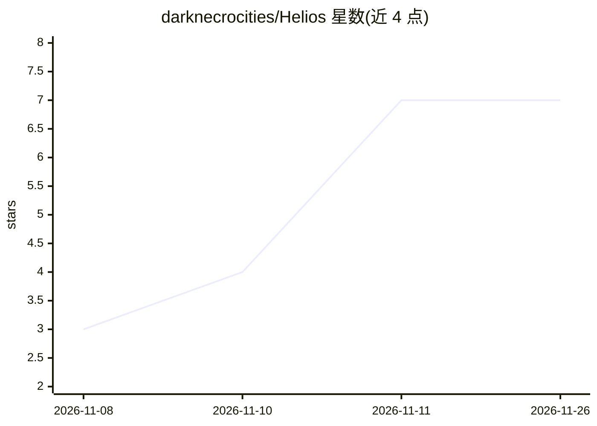

# darknecrocities/Helios

⭐ 7 · Python · NOASSERTION · 推送 2026-11-11 · [GitHub](https://github.com/darknecrocities/Helios) · [官网](https://openhelios.vercel.app) · 个人维护

**开源开放权重的分层语言模型家族，可本地运行**

由个人开发者 Arron Kian Parejas 维护的开放权重模型家族，含 Nano 到 Flagship 六个参数量级（17.84M–5.80B），支持文本、工具调用（MCP），Core 以上层级支持图像输入。通过 Ollama 分发并在本地运行，提供本地 HTTP API 与 Python/JavaScript 示例，另附 OpenCode provider 配置。评估覆盖 MMLU、GSM8K、MedMCQA 等基准；README 未提供本地安装/训练路径，运行依赖 Ollama。

## 筛选速览

| 维度 | 判定 | 备注 |
|---|---|---|
| AI 角色 | `ai-native` | 本体是模型或模型工具 |
| 许可风险 | `none` | NOASSERTION |
| 部署形态 | `None` |  |
| 模型依赖 | local-ok | 支持本地模型 |
| 硬件要求 | — | 无带数字的原话,不猜 |
| 安装摩擦 | `low` | 无编译、无系统依赖或容器化 |
| 成熟度 | — | 结构信号不足 |

## 能力要点

- 六个参数量级（17.84M–5.80B），按容量与资源消耗分层
- 全层级支持工具调用（MCP），Core 以上支持图像+文本多模态
- 通过 Ollama 本地运行并提供本地 HTTP API
- 英-菲/他加禄双语对话支持

## 适用场景

- 在个人电脑或轻量设备上本地运行语言模型
- 将本地模型 API 接入自己的应用或脚本
- 在 OpenCode 等编码工具中配置本地模型

## 场景标签

`多模态` · 领域:感知与多模态

## 证据(README 行号)

> L3: **HELIOS** is an open-source, open-weight AI model ecosystem developed by **Arron Kian Parejas**. It is designed to 
> L11: HELIOS is an evolving family of language models built around a modular architecture and a collection of capabilitie
> L34: |HELIOS Nano|17.84M|16K|397 MB|Text, Tools|

## 星数曲线

2026-11-08 3 → 2026-11-26 7（+4）

---
*卡片 v1 · prompt 1.4 · 生成 2026-11-20 · 置信度 high · 依据 README sha `6827e75d4b15` · [字段定义](../../DATASET.md)*
