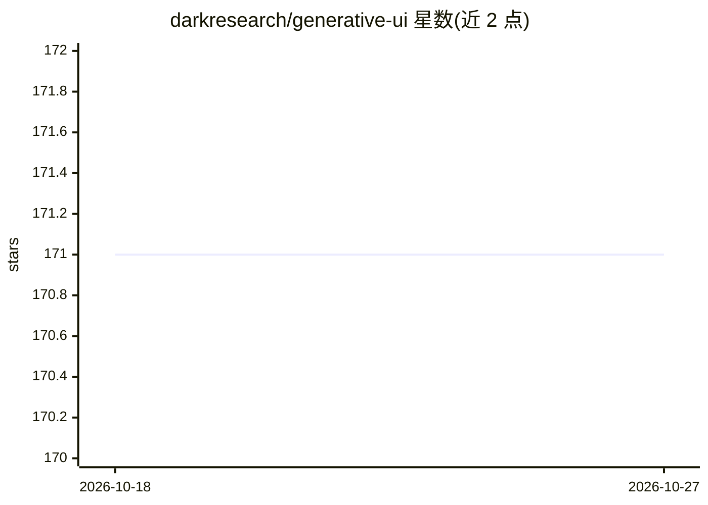

# darkresearch/generative-ui

⭐ 171 · TypeScript · 推送 2026-01-06 · [GitHub](https://github.com/darkresearch/generative-ui) · 个人维护

**Expo/React Native 生成式 UI 工具与模板：流式 Markdown 渲染**

面向移动端（Expo 优化）的生成式 UI 工具与模板集合，monorepo 结构。核心包 streamdown-rn 是高性能流式 Markdown 渲染器，支持边流边渲、骨架屏渐进组件注入、GFM 全支持与内置 XSS 防护；另有实验性 2D 生成式 UI 画布 galerie-rn（当前为占位 stub）。附带 Web 版调试器（端口 8081）与 iOS 真机调试伴侣（WebSocket 连接）。仓库声明针对 AI 辅助开发工作流优化，见 AGENTS.md。

## 筛选速览

| 维度 | 判定 | 备注 |
|---|---|---|
| AI 角色 | `ai-ecosystem` | LLM/agent 周边工具 |
| 许可风险 | `none` | — |
| 部署形态 | `library` | 以包/库形式分发 |
| 模型依赖 | — | README 未给出锁定关系 |
| 硬件要求 | — | 无带数字的原话,不猜 |
| 安装摩擦 | `low` | 无编译、无系统依赖或容器化 |
| 成熟度 | — | 结构信号不足 |

## 能力要点

- streamdown-rn 流式优先渲染与 format-as-you-type 体验
- 渐进组件流式注入带骨架屏
- 完整 GFM 支持与内置 XSS 防护
- Web 与 iOS 双调试器（WebSocket 联动）

## 适用场景

- 为移动端聊天应用渲染 LLM 流式输出的 Markdown
- 调试流式内容渲染与动态组件注入
- 作为 Expo 新应用的起步模板

## 场景标签

 · 领域:移动开发/LLM 前端组件

## 证据(README 行号)

> L8: Tools and templates for building generative UI applications. Mobile-first, optimized for Expo.
> L14: High-performance streaming markdown renderer with dynamic component injection.

## 星数曲线

2026-10-18 171 → 2026-10-27 171（+0）

---
*卡片 v1 · prompt 1.4 · 生成 2026-10-22 · 置信度 high · 依据 README sha `b3f3e1c092ae` · [字段定义](../../DATASET.md)*
