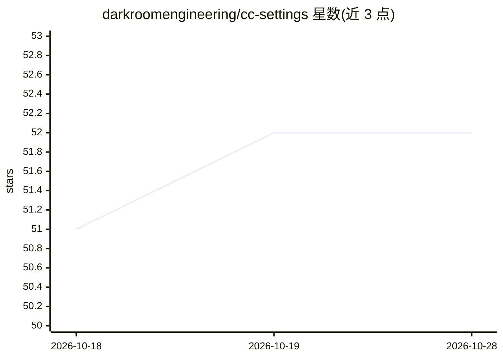

# darkroomengineering/cc-settings

⭐ 52 · TypeScript · MIT · 推送 2026-10-28 · [GitHub](https://github.com/darkroomengineering/cc-settings) · 组织维护

**给 Claude Code/Codex 装团队工程规范的工作流配置包**

Darkroom Engineering 团队维护的 Claude Code 与 Codex 配置集合：通过 npx/curl/PowerShell 一键安装 agents、25 个技能工作流、hooks 与编码规范（AGENTS.md/CLAUDE-FULL.md、12 条主题规则、6 套技术栈规范、9 个角色 agent），使新机器获得统一的标准、安全检查与发布前证明门（真实 typecheck/测试/lint）。不覆盖个人已有配置，支持 rollback、--light 精简层与自动更新。需先自行安装并认证 Claude Code 或 Codex，Node 18+ 或用免 Node 脚本。

## 筛选速览

| 维度 | 判定 | 备注 |
|---|---|---|
| AI 角色 | `ai-ecosystem` | LLM/agent 周边工具 |
| 许可风险 | `permissive` | MIT |
| 部署形态 | `library` | 以包/库形式分发 |
| 模型依赖 | — | README 未给出锁定关系 |
| 硬件要求 | — | 无带数字的原话,不猜 |
| 安装摩擦 | `low` | 无编译、无系统依赖或容器化 |
| 成熟度 | — | 结构信号不足 |

## 能力要点

- 25 个技能工作流（fix/build/review/ship/handoff 等）+ 9 个角色 agent
- hooks 阻止破坏性命令、发布前跑真实构建与测试的证明门
- 一键安装不覆盖个人配置，支持 rollback 与 --light 精简层
- 团队知识共享：/share-learning 沉淀到共享仓库供全队复用

## 适用场景

- 让团队的 Claude Code/Codex 在每台机器上遵循统一工程规范
- 用固定工作流替代口头约定：修复先复现、评审只读、发布先过测试
- 新成员 5 分钟完成开发环境配置对齐

## 场景标签

`编码 Agent` · 领域:编码与开发

## 证据(README 行号)

> L3: cc-settings gives Claude Code and Codex the Darkroom engineering team's standards, task workflows,
> L226: - **25 skills.** Named workflows selected from ordinary language or pinned with `/name` in Claude
> L229: - **9 role agents.** Planner, explorer, implementer, tester, reviewer, security reviewer,

## 星数曲线

2026-10-18 51 → 2026-10-28 52（+1）

---
*卡片 v1 · prompt 1.4 · 生成 2026-10-24 · 置信度 high · 依据 README sha `af4a14f8250b` · [字段定义](../../DATASET.md)*
