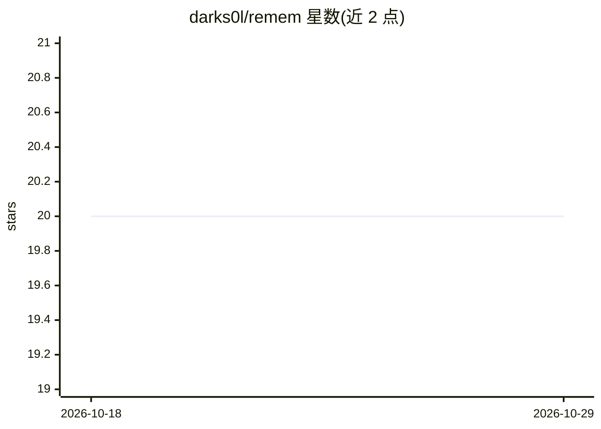

# darks0l/remem

⭐ 20 · TypeScript · 推送 2026-08-31 · [GitHub](https://github.com/darks0l/remem) · [官网](https://github.com/darks0l/remem#readme) · 个人维护

**给 AI agent 用的持久化可查询记忆层**

TypeScript 编写的框架无关 agent 记忆库：把事实、偏好、决策、过程等存到活动提示窗口之外，支持关键词+向量混合语义检索，SQLite 默认存储、PostgreSQL 可选，跨重启持久。提供 remember() 入库策略（分类、评分、去重、层级提示）、contextPack() 有界记忆简报用于 agent 交接、graph 图可视化、dream 长记忆主题综合、健康检查与存储维护等。附带终端 UI 与 CLI（remem init/ui/health 等）及 HTTP 接口，支持 OpenClaw/Hermes 等运行时接入。

## 筛选速览

| 维度 | 判定 | 备注 |
|---|---|---|
| AI 角色 | `ai-ecosystem` | LLM/agent 周边工具 |
| 许可风险 | `permissive` | — |
| 部署形态 | `library` | 以包/库形式分发 |
| 模型依赖 | local-ok | 支持本地模型 |
| 硬件要求 | — | 无带数字的原话,不猜 |
| 安装摩擦 | `low` | 无编译、无系统依赖或容器化 |
| 成熟度 | — | 结构信号不足 |

## 能力要点

- remember() 单次完成分类、入库评分、近重复跳过与层级提示
- SQLite 默认 / PostgreSQL 可选的事件溯源存储，快照备份恢复
- contextPack() 生成受字符预算约束的 agent 交接记忆简报（多 profile）
- 代码图谱作为记忆：导入可移植 node/edge 图并做加权影响遍历

## 适用场景

- 让聊天/编码 agent 拥有跨重启的持久记忆
- 多 agent 或远程 worker 交接时生成有界上下文简报
- 对记忆库做健康检查、去重整合与存储维护

## 场景标签

`Agent 记忆` · 领域:Agent 开发

## 证据(README 行号)

> L17: ReMEM is a lightweight, framework-agnostic memory substrate for AI agents. It gives agents a persistent memory laye
> L25: - **Drop-in agent memory** - store facts, preferences, decisions, procedures, and recent events outside the active 
> L240: - **Semantic search with vector embeddings** - Ollama (`nomic-embed-text`), 40% keyword + 60% cosine similarity hy

## 星数曲线

2026-10-18 20 → 2026-10-29 20（+0）

---
*卡片 v1 · prompt 1.4 · 生成 2026-10-28 · 置信度 high · 依据 README sha `d0782eaf2311` · [字段定义](../../DATASET.md)*
