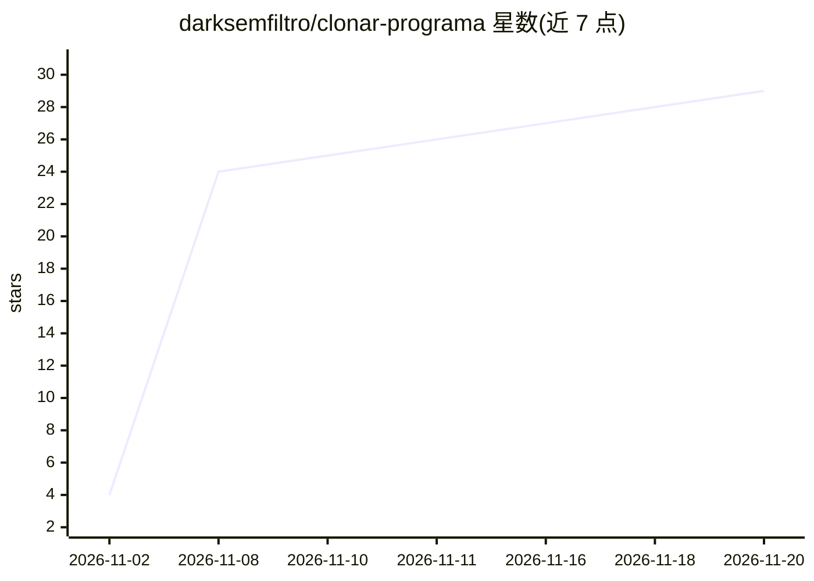

# darksemfiltro/clonar-programa

⭐ 29 · JavaScript · NOASSERTION · 推送 2026-11-01 · [GitHub](https://github.com/darksemfiltro/clonar-programa) · [官网](https://github.com/darksemfiltro/clonar-programa) · 个人维护

**引导 LLM 代理按证据-架构-spec 流程克隆网站与桌面程序的 skill**

面向 Claude Code、OpenCode、Codex、Gemini CLI 等代理的安装型 skill：通过五问访谈建立 workspace，用 Playwright 捕获网站、用 PowerShell 捕获 Windows 桌面窗口作为证据，再借助 REA（reverse-engineer-anything）重建架构、生成 spec 与功能清单，最后实现自有代码并用行为比较器验证与原程序的parity。提供 ZIP 与手动安装方式，需 Node.js 18+ 与 REA（需 Node 22.19+）。声明不绕过登录、paywall、DRM 或 CAPTCHA；许可限个人非商业用途。

## 筛选速览

| 维度 | 判定 | 备注 |
|---|---|---|
| AI 角色 | `ai-ecosystem` | LLM/agent 周边工具 |
| 许可风险 | `none` | NOASSERTION |
| 部署形态 | `desktop` | 安装包/桌面程序 |
| 模型依赖 | — | README 未给出锁定关系 |
| 硬件要求 | — | 无带数字的原话,不猜 |
| 安装摩擦 | `low` | 无编译、无系统依赖或容器化 |
| 成熟度 | — | 结构信号不足 |

## 能力要点

- 证据→架构→spec→自有实现→parity 验证的克隆方法论
- Playwright 网站捕获与 Windows 桌面窗口捕获脚本，含 token/密码脱敏
- 已安装程序清单（hashes、技术栈、许可、app.asar 内容）
- 行为比较器验证克隆与原程序的一致性

## 适用场景

- 让我的编程代理按结构化流程克隆一个网站或桌面程序
- 在动手前系统采集目标程序的行为证据并生成规格
- 验证我重写的实现与原程序行为一致

## 场景标签

`编码 Agent` · 领域:编码与开发

## 证据(README 行号)

> L5: **Uma skill para você clonar um site ou programa desktop sem começar do zero.** Ela guia a sua
> L28: 1. Abra um agente com acesso ao computador (Claude Code, OpenCode ou Codex).

## 星数曲线

2026-11-02 4 → 2026-11-20 29（+25）

---
*卡片 v1 · prompt 1.4 · 生成 2026-11-18 · 置信度 mid · 依据 README sha `a4d956103808` · [字段定义](../../DATASET.md)*
