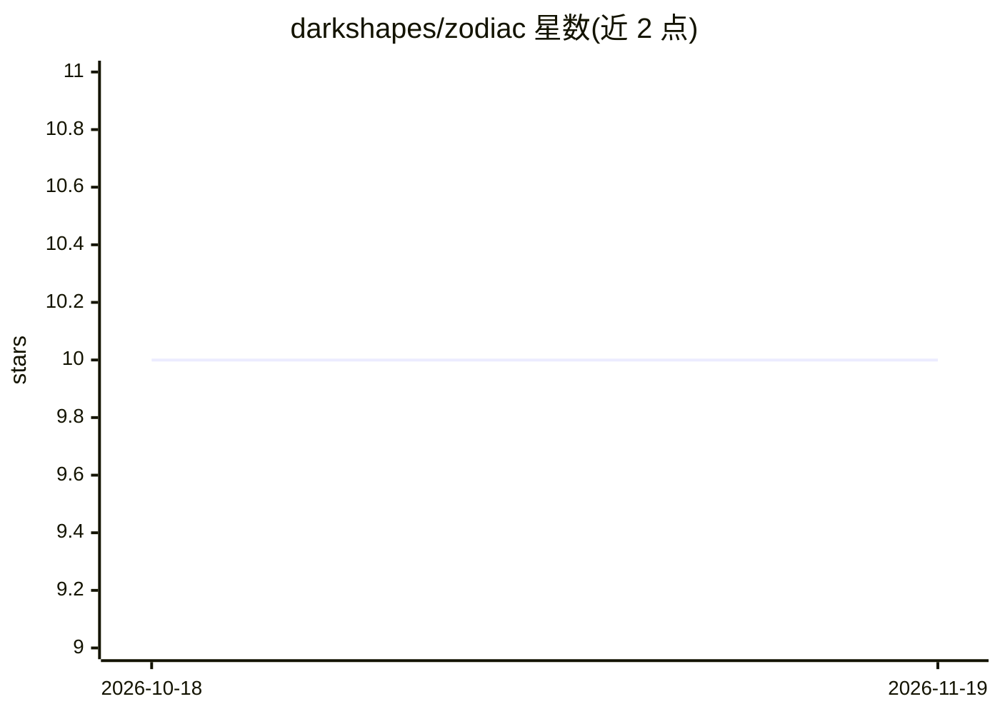

# darkshapes/zodiac

⭐ 10 · Python · NOASSERTION · 推送 2026-04-03 · [GitHub](https://github.com/darkshapes/zodiac) · 个人维护

**生成式 AI 工作流自动编排器：本地自动识别模型并构建流水线**

面向生成式 AI 的本地运行流水线自动化工具：用户以文本、音频或文件为输入，程序自动识别本机的模型（文本、图像、语音、视频等）并构建生成式工作流，无需编程即可串联动作链。本地运行、不打开外部连接、无遥测。以 Python 应用形式分发，通过 uv 安装源码运行，支持桌面、终端与浏览器界面。许可证为 MPL-2.0 + Commons Clause 1.0。

## 筛选速览

| 维度 | 判定 | 备注 |
|---|---|---|
| AI 角色 | `ai-ecosystem` | LLM/agent 周边工具 |
| 许可风险 | `none` | NOASSERTION |
| 部署形态 | `None` |  |
| 模型依赖 | local-ok | 支持本地模型 |
| 硬件要求 | — | 无带数字的原话,不猜 |
| 安装摩擦 | `low` | 无编译、无系统依赖或容器化 |
| 成熟度 | — | 结构信号不足 |

## 能力要点

- 根据文本/音频/文件输入自动识别模型并构建生成式工作流
- 本地运行：无数据外传、无远程遥测或分析
- 兼容旧款消费级 CPU/TPU/GPU 设备，适配手机、CLI 与浏览器
- 支持接入 Ollama、Llamafile、Cortex/Jan、VLLM、LMStudio、HuggingFace 等模型来源

## 适用场景

- 不写代码地把本地多个生成式模型串成工作流
- 在旧设备或离线环境下运行生成式 AI 任务
- 面向艺术创作、故事叙述与研究的多模型管线搭建

## 场景标签

`工作流自动化` · 领域:效率与自动化

## 证据(README 行号)

> L16: Zodiac is a creative research platform for Generative AI. Guided by text, audio, or files, it identifies your model
> L26: - Bring your own models - Supports Ollama, Llamafile, Cortex/Jan, VLLM, LMStudio, HuggingFace

## 星数曲线

2026-10-18 10 → 2026-11-19 10（+0）

---
*卡片 v1 · prompt 1.4 · 生成 2026-11-19 · 置信度 mid · 依据 README sha `f034190ed68c` · [字段定义](../../DATASET.md)*
