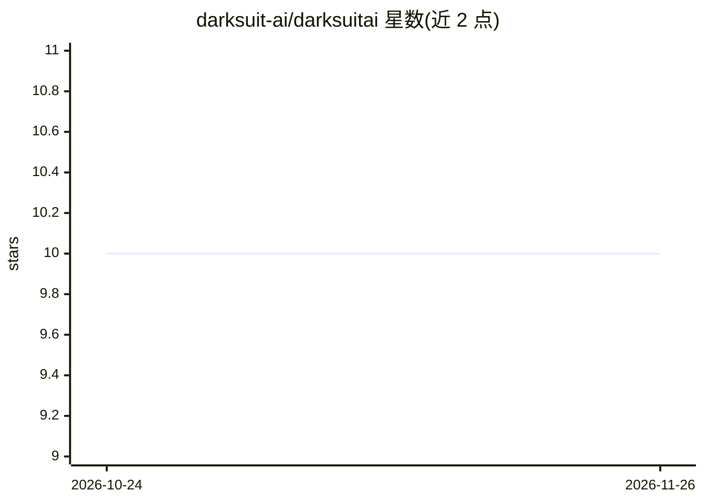

# darksuit-ai/darksuitai

⭐ 10 · Go · GPL-3.0 · 推送 2026-07-18 · [GitHub](https://github.com/darksuit-ai/darksuitai) · 组织维护

**Go 语言的 agentic AI 框架：在同一后端进程中构建 LLM agent**

DarkSuitAI 是一个以 Go 编写的 agent 框架，作为单一依赖编译为单一二进制文件，用于在后端同一进程内构建 LLM agent。核心机制包括：provider 侧原生工具调用（带 XML/ReAct 回退）、滚动摘要压缩与语义向量召回的上下文与内存管理、通过 Observer 接口输出的运行/LLM/工具遥测（stdout 与 LangSmith 导出器、OpenTelemetry 适配器）、最大迭代与无进展检测的循环护栏，以及统一的流式输出。需要 Go 1.24+。README 声明目前不包含图式多智能体编排、持久检查点与人工审批门。

## 筛选速览

| 维度 | 判定 | 备注 |
|---|---|---|
| AI 角色 | `ai-ecosystem` | LLM/agent 周边工具 |
| 许可风险 | `viral` | GPL-3.0 |
| 部署形态 | `None` |  |
| 模型依赖 | — | README 未给出锁定关系 |
| 硬件要求 | — | 无带数字的原话,不猜 |
| 安装摩擦 | `low` | 无编译、无系统依赖或容器化 |
| 成熟度 | — | 结构信号不足 |

## 能力要点

- 原生工具调用与 XML/ReAct 可移植回退
- 滚动摘要压缩与语义向量召回的上下文/内存工程
- 内置可观测性：Observer 接口、stdout/LangSmith 导出器、OTel 适配器
- Anthropic/OpenAI/Gemini/Groq 统一接口，均使用官方 SDK

## 适用场景

- Go 后端项目中加入 agent 能力而无需部署 Python 服务
- 生产环境运行 agent 并需要遥测与循环护栏
- 需要跨 provider 灵活切换模型的 agent 应用

## 场景标签

`Agent 框架` `LLM 可观测性` · 领域:Agent 开发

## 证据(README 行号)

> L3: ### Production-ready AI agents in **pure Go** — no Python sidecar, no bloat.
> L19: **DarkSuitAI keeps agents in the same language as your backend.** It ships as a single dependency, compiles to a si
> L34: - are building LLM agents and want them **in Go**, running in the same process as your backend — no separate Python

## 星数曲线

2026-10-24 10 → 2026-11-26 10（+0）

---
*卡片 v1 · prompt 1.4 · 生成 2026-11-20 · 置信度 high · 依据 README sha `51d2f1a5021b` · [字段定义](../../DATASET.md)*
