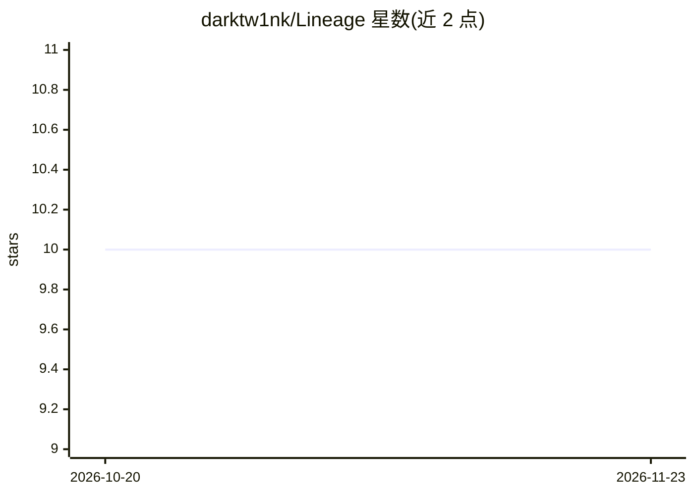

# darktw1nk/Lineage

⭐ 10 · TypeScript · MIT · 推送 2026-08-03 · [GitHub](https://github.com/darktw1nk/Lineage) · 个人维护

**用遗传算法在真实模型上进化优化 LLM 提示词的工具**

将提示词视作基因组：生成候选变体种群，在用户自备的测试集上用真实模型评分，按 Top-K/Top-P 选择父代，经五种算子（变异、交叉、元提示、参数与模型变异）繁殖下一代，最终冠军在 holdout 测试上验证。适应度为质量、安全、成本、延迟、稳定性五维加权，支持预算上限、成本预估与可复现 seed。提供 npm 全局安装的 CLI（JSON 进出、退出码、预算封顶）与 Windows/macOS/Linux 桌面应用（展示谱系图），二者驱动同一引擎，并附带供编码 agent 使用的 evolving-prompts 技能。

## 筛选速览

| 维度 | 判定 | 备注 |
|---|---|---|
| AI 角色 | `ai-ecosystem` | LLM/agent 周边工具 |
| 许可风险 | `permissive` | MIT |
| 部署形态 | `library` | 以包/库形式分发 |
| 模型依赖 | local-ok | 支持本地模型 |
| 硬件要求 | — | 无带数字的原话,不猜 |
| 安装摩擦 | `low` | 无编译、无系统依赖或容器化 |
| 成熟度 | — | 结构信号不足 |

## 能力要点

- 遗传算法进化提示词，冠军在 holdout 测试上验证
- 五维加权适应度：quality/safety/cost/latency/stability
- 五种繁殖算子可插拔，约 20 行 JS 即可加入自定义算子
- CLI（面向 CI/agent）与 Electron 桌面应用（谱系图）双形态

## 适用场景

- 在测试集上自动搜索比手写更好的系统提示词
- 按预算/延迟约束寻找质量达标且成本最低的提示词与模型组合
- 模型版本更新后重跑进化以检测提示词是否回归

## 场景标签

`提示工程` · 领域:Agent 开发

## 证据(README 行号)

> L11: Lineage treats a prompt like a genome: it spawns a population of variants, scores every one
> L75: npm i -g @voxor/lineage-cli
> L94: **Desktop app** — download an installer for Windows, macOS or Linux. Installers are unsigned, so the first run need

## 星数曲线

2026-10-20 10 → 2026-11-23 10（+0）

---
*卡片 v1 · prompt 1.4 · 生成 2026-11-19 · 置信度 high · 依据 README sha `8fac60826d1f` · [字段定义](../../DATASET.md)*
