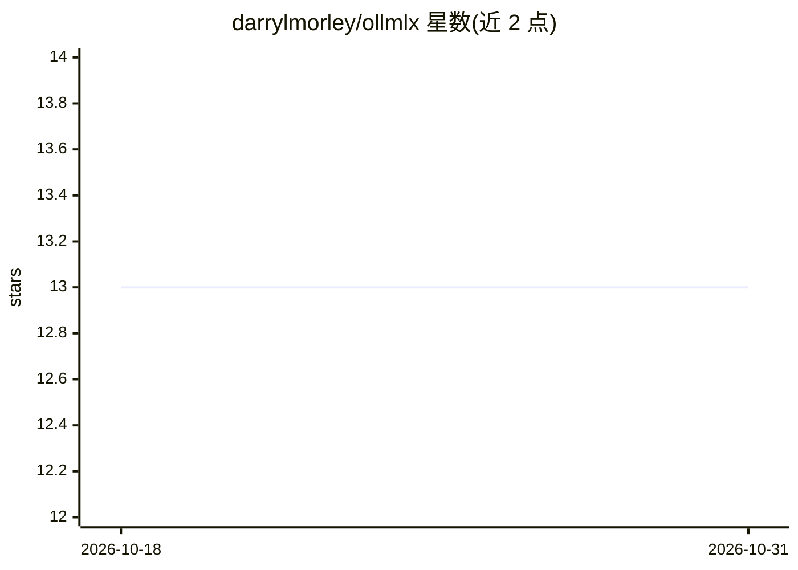

# darrylmorley/ollmlx

⭐ 13 · Swift · 推送 2026-05-20 · [GitHub](https://github.com/darrylmorley/ollmlx) · 个人维护

**Apple Silicon 上通过 mlx-lm 运行本地 LLM 的菜单栏应用与 CLI**

面向 Apple Silicon Mac 用户的本地 LLM 运行工具：以 mlx-lm 为后端，提供菜单栏应用与 CLI（serve/run/pull/list 等 9 个命令），在 localhost:11434 暴露 OpenAI 兼容与 Ollama 兼容两套 API，现有 Ollama 客户端无需改配置即可接入，并可安装 ollama 命令 shim。首次启动自动引导 Python 环境并从 Hugging Face 拉取模型。限制：同时仅运行一个模型、仅支持 Apple Silicon、与 Ollama 端口冲突需手动处理。

## 筛选速览

| 维度 | 判定 | 备注 |
|---|---|---|
| AI 角色 | `ai-ecosystem` | LLM/agent 周边工具 |
| 许可风险 | `none` | — |
| 部署形态 | `desktop` | 安装包/桌面程序 |
| 模型依赖 | local-ok | 支持本地模型 |
| 硬件要求 | — | 无带数字的原话,不猜 |
| 安装摩擦 | `low` | 无编译、无系统依赖或容器化 |
| 成熟度 | — | 结构信号不足 |

## 能力要点

- 菜单栏应用 + CLI，9 个命令管理本地模型
- 同端口暴露 OpenAI 兼容与 Ollama 兼容 API，Ollama 客户端可直接迁移
- 首次启动自动安装 uv 并创建 venv 引导 mlx-lm
- 可创建 ollama 兼容 symlink 供直接调用 ollama 二进制的脚本使用

## 适用场景

- 在 Mac 菜单栏一键启停本地模型并切换/拉取模型
- 把 Open WebUI、Cursor 等现有 Ollama 客户端指向本地 MLX 服务
- 脚本中用 ollaml pull/run 在终端交互本地模型

## 场景标签

`推理引擎` · 领域:训练与推理

## 证据(README 行号)

> L3: Run local LLMs on Apple Silicon via mlx-lm. Menubar app + CLI with OpenAI-compatible and Ollama-compatible APIs on `
> L82: ollmlx exposes both OpenAI-compatible (`/v1/chat/completions`, `/v1/models`) and Ollama-compatible (`/api/tags`, `/

## 星数曲线

2026-10-18 13 → 2026-10-31 13（+0）

---
*卡片 v1 · prompt 1.4 · 生成 2026-10-31 · 置信度 high · 依据 README sha `d613d1c109ca` · [字段定义](../../DATASET.md)*
