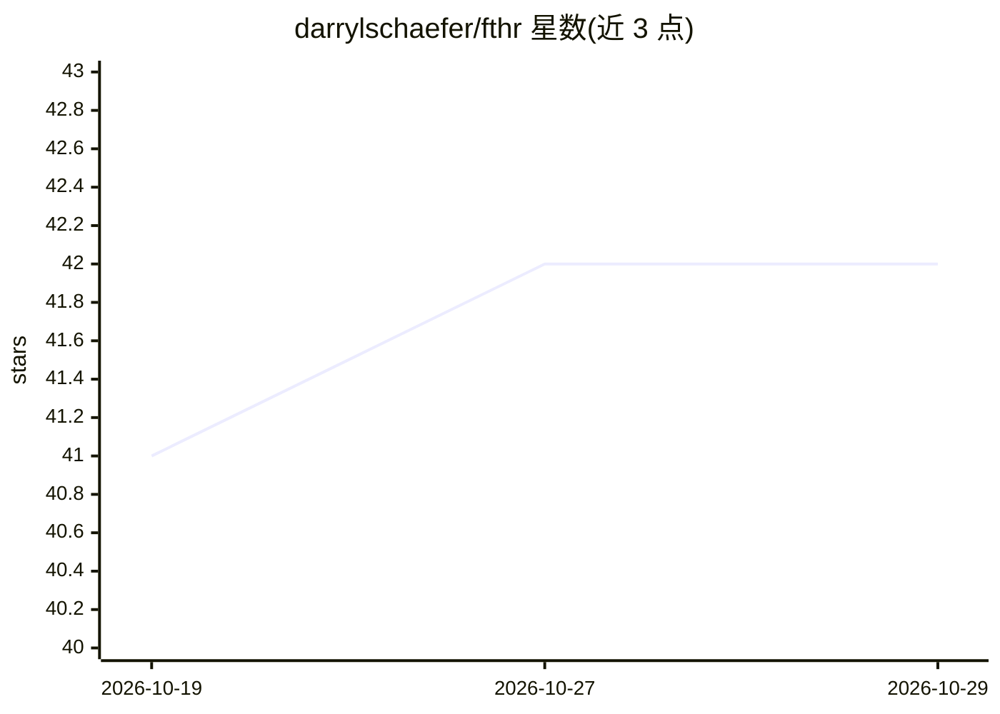

# darrylschaefer/fthr

⭐ 42 · TypeScript · MIT · 推送 2026-10-25 · [GitHub](https://github.com/darrylschaefer/fthr) · [官网](https://fthr.vercel.app/) · 个人维护

**浏览器端可定制写作工作区，集成 AI 助手、宏与语义搜索**

在浏览器中运行的可定制文字处理工作区：文档库、编辑器与 AI 助手合于一体。用户可将选中文本发送给 AI，配置带自定义指令与模型设置的 agent，保存可复用的宏（每个宏可单独设置模型）；支持引用笔记与文档元数据的上下文提示、写作版本与检查点、关键词/嵌入语义/混合搜索。文档与 API key 存储在本地浏览器 IndexedDB，AI 功能需连接用户自有 API key；无 key 也可纯编辑使用。本地运行需 Node.js 24.x 与 npm，数据不跨浏览器自动同步，导出不含 agent 对话与检查点。

## 筛选速览

| 维度 | 判定 | 备注 |
|---|---|---|
| AI 角色 | `ai-enhanced` | 去掉 AI 部分产品仍成立 |
| 许可风险 | `permissive` | MIT |
| 部署形态 | `None` |  |
| 模型依赖 | — | README 未给出锁定关系 |
| 硬件要求 | — | 无带数字的原话,不猜 |
| 安装摩擦 | `low` | 无编译、无系统依赖或容器化 |
| 成熟度 | — | 结构信号不足 |

## 能力要点

- 可配置的 AI agent，带读取、搜索与编辑文档的工具
- 宏系统：对选中段落运行保存的提示，每个宏独立模型设置
- 语义/混合检索与统一命令面板式工作区搜索（搜索本地运行）
- 文档、偏好与 API key 存储于浏览器 IndexedDB，连接自有 key

## 适用场景

- 写作时把选段发给 AI 做改写、润色或思路展开
- 为重复的写作/编辑任务保存提示宏一键复用
- 在本地浏览器中组织带版本、检查点和元数据的文档库

## 场景标签

`AI 写作` `AI 助手` `知识库管理` · 领域:对话与助手

## 证据(README 行号)

> L14: fthr is a customizable word processor that brings your documents, AI agents, and reusable macros into one workspace
> L41: Open **fthr.vercel.app** to start writing. You can dismiss the API-key prompt to use the editor without AI.

## 星数曲线

2026-10-19 41 → 2026-10-29 42（+1）

---
*卡片 v1 · prompt 1.4 · 生成 2026-10-25 · 置信度 high · 依据 README sha `648b61a302c9` · [字段定义](../../DATASET.md)*
