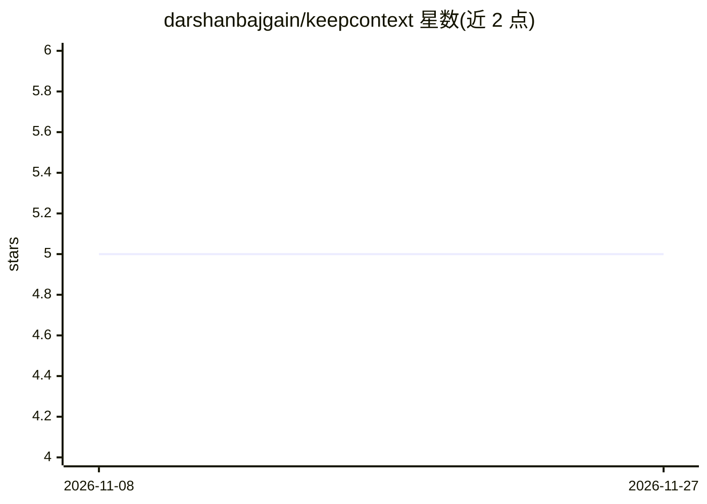

# darshanbajgain/keepcontext

⭐ 5 · JavaScript · AGPL-3.0 · 推送 2026-11-06 · [GitHub](https://github.com/darshanbajgain/keepcontext) · 个人维护

**自托管跨 AI 应用的共享记忆与任务接续 MCP 服务器**

KeepContext 是一个带 Web 仪表盘和单一 MCP 端点的自托管服务器：ChatGPT、Claude（web/桌面/Claude Code）、Gemini（web/CLI）、Cursor、Codex、GitHub Copilot、Antigravity 均可接入，通过 get_context/save_entry 等工具共享想法、决策、待办与常设指令。多步任务以 git 分支上的检查点记录，一个应用达到用量上限后另一个可 resume_task 接续。数据存于本地 SQLite，每个应用独立 token（仅存哈希），GitHub 接入为只读。提供 Docker 与 Node 22+ 两种运行方式，支持 arm64。

## 筛选速览

| 维度 | 判定 | 备注 |
|---|---|---|
| AI 角色 | `ai-ecosystem` | LLM/agent 周边工具 |
| 许可风险 | `viral` | AGPL-3.0 |
| 部署形态 | `self-host` | docker 或自建部署 |
| 模型依赖 | — | README 未给出锁定关系 |
| 硬件要求 | — | 无带数字的原话,不猜 |
| 安装摩擦 | `low` | 无编译、无系统依赖或容器化 |
| 成熟度 | — | 结构信号不足 |

## 能力要点

- 单一 MCP 端点连接多个 AI 应用，共享同一份记忆
- 任务检查点存储在 git 分支上，跨应用接续未完成任务
- 每应用独立 token（SHA-256 哈希存储），仪表盘显示来源徽章
- 私有条目不发送给通过 URL 连接的 web 应用

## 适用场景

- 在 ChatGPT 记录的想法让 Claude、Cursor 等也能读取
- Claude Code 达到用量上限后由 Codex 或 Copilot 接续编码任务
- 学生和研究者跨多个 AI 助手同步笔记、待办与项目状态

## 场景标签

`知识库管理` `Agent 记忆` · 领域:Agent 开发

## 证据(README 行号)

> L7: KeepContext is a small server with a web dashboard and one MCP endpoint. ChatGPT, Claude (web, desktop, Claude Code)
> L29: - **One memory for all your AI apps.** Ideas, decisions, todos, notes, standing instructions ("keep answers short")
> L30: - **Continue anywhere.** For multi-step coding work, apps start a task and save a short checkpoint after each step 

## 星数曲线

2026-11-08 5 → 2026-11-27 5（+0）

---
*卡片 v1 · prompt 1.4 · 生成 2026-11-21 · 置信度 high · 依据 README sha `7c928af9447b` · [字段定义](../../DATASET.md)*
