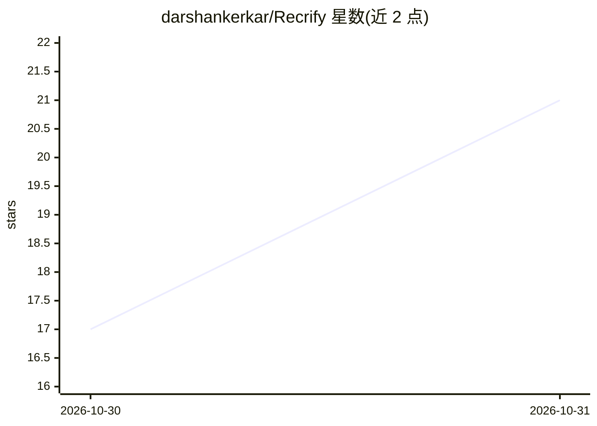

# darshankerkar/Recrify

⭐ 21 · JavaScript · MIT · 推送 2026-10-29 · [GitHub](https://github.com/darshankerkar/Recrify) · [官网](https://recrify.co) · 个人维护

**面向招聘方与候选人的 AI 辅助招聘平台**

基于 React 19 + Django 的招聘 Web 平台，覆盖双端角色流程：招聘方管理职位、批量处理简历、安排与监控面试、查看仪表盘；候选人浏览职位、上传简历、用 AI 简历分析器获得评分与改进建议、跟踪申请并进入浏览器端面试间。AI 为嵌入功能（简历分析、聊天助手），集成 Google Generative AI、Firebase 认证、Cashfree 支付与 PeerJS/face-api.js 实时面试工具。通过克隆源码部署，另有在线站点。

## 筛选速览

| 维度 | 判定 | 备注 |
|---|---|---|
| AI 角色 | `ai-enhanced` | 去掉 AI 部分产品仍成立 |
| 许可风险 | `permissive` | MIT |
| 部署形态 | `None` |  |
| 模型依赖 | — | README 未给出锁定关系 |
| 硬件要求 | — | 无带数字的原话,不猜 |
| 安装摩擦 | `low` | 无编译、无系统依赖或容器化 |
| 成熟度 | — | 结构信号不足 |

## 能力要点

- AI 简历分析器：角色匹配反馈、评分与改进建议
- 招聘方批量简历上传与候选人管理
- 浏览器端面试间与面试监控附加包购买
- 订阅计划与 Cashfree 支付集成

## 适用场景

- 招聘团队发布职位、筛选简历并管理面试流程
- 候选人获取简历质量分析并跟踪申请进度
- 在浏览器中进行线上面试并购买监控额度

## 场景标签

`文档问答` `聊天机器人` · 领域:对话与助手

## 证据(README 行号)

> L26: - **AI Resume Analyzer** - Candidates can receive role-based feedback, score-oriented analysis, and resume improvem
> L27: - **AI Chat Assistant** - Embedded assistant for platform guidance and hiring-related interactions.

## 星数曲线

2026-10-30 17 → 2026-10-31 21（+4）

---
*卡片 v1 · prompt 1.4 · 生成 2026-10-30 · 置信度 high · 依据 README sha `1ab809ea94aa` · [字段定义](../../DATASET.md)*
