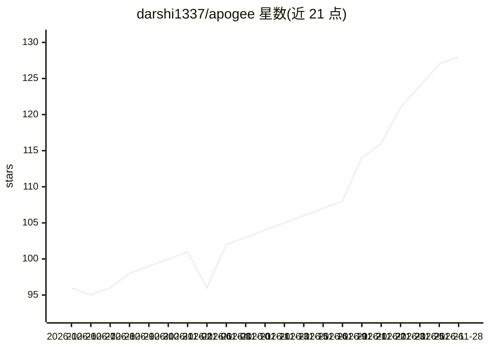

# darshi1337/apogee

⭐ 128 · JavaScript · MIT · 推送 2026-11-27 · [GitHub](https://github.com/darshi1337/apogee) · [官网](https://darshi1337.github.io/apogee/) · 个人维护

**本地优先的浏览器 AI 摘要扩展：为网页/视频/PDF/DOCX 生成摘要**

离线优先的浏览器扩展，对文章、视频、PDF、DOCX 与粘贴文本生成摘要与问答。浏览器内生成走 WebGPU（Chromium）或 WebAssembly（Firefox 默认），也可连接本机 Ollama 或 llama-server；远程生成（OpenRouter/OpenCode）需单独同意并使用用户自己的 key。提供 37 种输出语言翻译、来源句高亮回跳、时间戳视频时间线、敏感站点缓存排除。通过 Chrome Web Store 与 Firefox Add-ons 安装，MIT 许可。

## 筛选速览

| 维度 | 判定 | 备注 |
|---|---|---|
| AI 角色 | `ai-native` | 本体是模型或模型工具 |
| 许可风险 | `permissive` | MIT |
| 部署形态 | `library` | 以包/库形式分发 |
| 模型依赖 | local-ok | 支持本地模型 |
| 硬件要求 | — | 无带数字的原话,不猜 |
| 安装摩擦 | `low` | 无编译、无系统依赖或容器化 |
| 成熟度 | — | 结构信号不足 |

## 能力要点

- 本地生成默认运行：分词、推理、检索、缓存均在设备端
- WebGPU/WASM 浏览器内推理，或 127.0.0.1 回环连接 Ollama 与 llama-server
- 摘要要点点击可滚动到页面来源句（grounding）
- 支持 37 种输出语言翻译与自定义提示指令

## 适用场景

- 在浏览器里本地总结文章、PDF、DOCX 与粘贴文本
- 为 YouTube/Bilibili 视频生成交互式时间线并跳转关键片段
- 对长文档做本地检索问答
- 在无网络环境下使用已缓存模型进行摘要

## 场景标签

`文档问答` `AI 写作` `文档解析` · 领域:内容生成

## 证据(README 行号)

> L5: A local-by-default AI summarizer in your browser for articles, videos, PDFs, DOCX files, and pasted text. It runs on
> L19: Apogee is an AI browser assistant for articles, videos, emails, and more. In-browser generation uses your GPU with 
> L25: > Apogee summarizes pages, videos, PDFs, DOCX files, and pasted text locally by default. Local generation needs no 

## 星数曲线

2026-10-26 96 → 2026-11-28 128（+32）

---
*卡片 v1 · prompt 1.4 · 生成 2026-11-28 · 置信度 mid · 依据 README sha `ac853f7fa6ba` · [字段定义](../../DATASET.md)*
