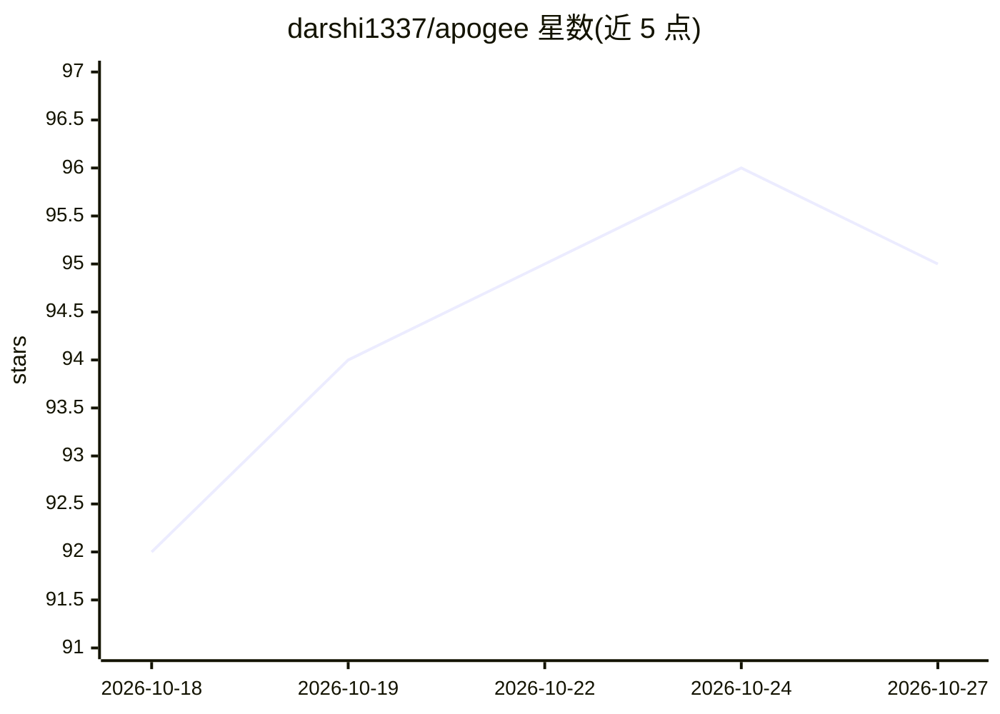

# darshi1337/apogee

⭐ 95 · JavaScript · MIT · 推送 2026-10-26 · [GitHub](https://github.com/darshi1337/apogee) · [官网](https://darshi1337.github.io/apogee/) · 个人维护

**浏览器本地 AI 摘要扩展：离线总结网页/视频/PDF**

Chrome/Firefox 浏览器扩展，在本地对文章、YouTube/Bilibili 视频、PDF、DOCX 与粘贴文本生成摘要和问答。推理在浏览器内经 WebGPU（GPU）或 WebAssembly（CPU）完成，也可连接本地 Ollama 或 llama.cpp 的 llama-server（仅限 127.0.0.1 回环）。无需账号、API key 或云端上传，首次运行下载模型后可离线缓存。支持选中文本摘要、带时间轴的视频摘要、来源句高亮定位、32 种语言翻译。受已停产的 Mozilla Orbit 启发，MIT 许可。

## 筛选速览

| 维度 | 判定 | 备注 |
|---|---|---|
| AI 角色 | `ai-native` | 本体是模型或模型工具 |
| 许可风险 | `permissive` | MIT |
| 部署形态 | `library` | 以包/库形式分发 |
| 模型依赖 | local-ok | 支持本地模型 |
| 硬件要求 | — | 无带数字的原话,不猜 |
| 安装摩擦 | `low` | 无编译、无系统依赖或容器化 |
| 成熟度 | — | 结构信号不足 |

## 能力要点

- WebGPU/WebAssembly 浏览器内推理，无需后端或 API key
- 可直连本地 Ollama 或 llama.cpp 的 llama-server（限回环地址）
- 支持文章、视频、PDF/DOCX、社交讨论串与选中文本的摘要及问答
- 摘要要点可定位回原文出处句（Chromium）

## 适用场景

- 浏览网页或看视频时快速生成本地摘要
- 在无网络或注重隐私的环境下总结文档与邮件外内容
- 连接自家 Ollama/llama.cpp 服务使用更大的模型

## 场景标签

`文档问答` · 领域:知识与检索

## 证据(README 行号)

> L5: A private AI summarizer in your browser for articles, videos, PDFs, DOCX files, and pasted text. It runs on WebGPU, 
> L19: Apogee is an AI browser assistant for articles, videos, emails, and more. It runs fully in your browser. It uses yo
> L25: > **In short:** Apogee summarizes pages, videos, PDFs, DOCX files, and pasted text locally. It needs no account, AP

## 星数曲线

2026-10-18 92 → 2026-10-27 95（+3）

---
*卡片 v1 · prompt 1.4 · 生成 2026-10-23 · 置信度 mid · 依据 README sha `6b688959cf74` · [字段定义](../../DATASET.md)*
