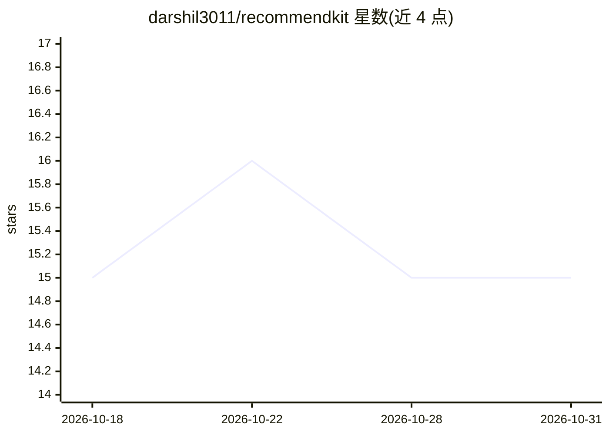

# darshil3011/recommendkit

⭐ 15 · Python · 推送 2026-04-10 · [GitHub](https://github.com/darshil3011/recommendkit) · 个人维护

**双塔推荐系统框架：JSON 配置即用的训练与推理库**

基于 PyTorch 的两塔（two-tower）推荐系统库，提供训练、推理与模型持久化流程。通过 JSON 配置切换 SimpleFusion（拼接+MLP）与注意力融合两种架构；自动从交互数据生成正负样本。编码器覆盖文本（HuggingFace 任意模型、word2vec）、图像（CNN/ResNet/ViT）、类别、连续与时间特征，支持继承 BaseEncoder 自定义组件；支持 CUDA 与分布式训练。面向需在各行业域快速搭建生产级推荐的开发者，提供 quickstart Jupyter 笔记本与合成数据生成脚本。

## 筛选速览

| 维度 | 判定 | 备注 |
|---|---|---|
| AI 角色 | `ai-native` | 本体是模型或模型工具 |
| 许可风险 | `none` | — |
| 部署形态 | `None` |  |
| 模型依赖 | — | README 未给出锁定关系 |
| 硬件要求 | — | 无带数字的原话,不猜 |
| 安装摩擦 | `medium` | 含编译或系统依赖之一 |
| 成熟度 | — | 结构信号不足 |

## 能力要点

- 两塔架构，JSON 配置切换 SimpleFusion 与注意力融合
- 自动正负样本生成与可配置正负比例
- 模块化编码器：文本/图像/类别/连续/时间特征，支持自定义编码器
- CUDA 加速与多 GPU 分布式训练

## 适用场景

- 为电商、内容、社交媒体等场景训练个性化推荐模型
- 生成用户/物品向量并输出 Top-K 推荐
- 用合成相关数据集快速验证推荐流程

## 场景标签

`推荐系统` · 领域:学习与行业

## 证据(README 行号)

> L5:  A ready-to-use, out-of-the-box library for training scalable, two-tower network based recommendation systems. Built
> L10: - **Two-tower Architecture**: Follows industry standard two-tower model architecture for user and items

## 星数曲线

2026-10-18 15 → 2026-10-31 15（+0）

---
*卡片 v1 · prompt 1.4 · 生成 2026-10-30 · 置信度 high · 依据 README sha `e0a083944a11` · [字段定义](../../DATASET.md)*
