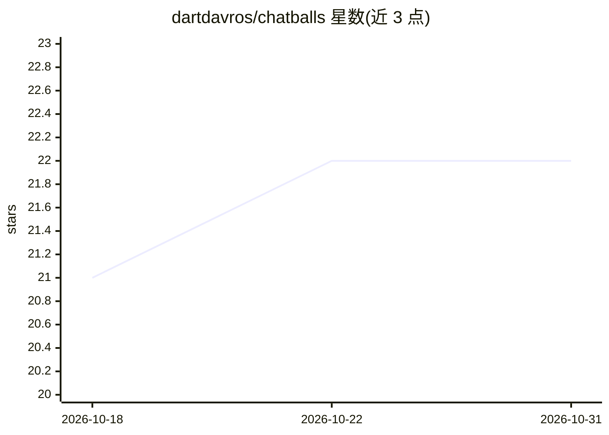

# dartdavros/chatballs

⭐ 22 · Python · AGPL-3.0 · 推送 2026-10-16 · [GitHub](https://github.com/dartdavros/chatballs) · [官网](https://chatballs.ru) · 个人维护

**自托管 AI 客服平台：在多渠道自动应答客户，难题转人工**

面向企业客服场景的自托管平台：AI agent 基于自有知识库在 Telegram、MAX、VK、邮件与网页聊天中自动回复；不确定或客户要求时转人工并通知坐席。通过 Docker Compose 单命令部署，数据留在本地服务器；AI 模型自带 key 接入 OpenRouter、任意 OpenAI 兼容服务或本地模型。含知识库语义搜索、公开帮助中心、网页聊天挂件、音视频通话、坐席工作台与客户统一档案。要求 Linux x86_64 服务器与开放 80/443 等端口。

## 筛选速览

| 维度 | 判定 | 备注 |
|---|---|---|
| AI 角色 | `ai-native` | 本体是模型或模型工具 |
| 许可风险 | `viral` | AGPL-3.0 |
| 部署形态 | `desktop` | 安装包/桌面程序 |
| 模型依赖 | locked-api |  |
| 硬件要求 | — | 无带数字的原话,不猜 |
| 安装摩擦 | `low` | 无编译、无系统依赖或容器化 |
| 成熟度 | — | 结构信号不足 |

## 能力要点

- 多渠道（Telegram/MAX/VK/邮件/网页挂件）统一会话列表与人工接管
- 知识库语义搜索，无 embeddings 时回退全文检索
- 自带 key 接入 OpenRouter、OpenAI 兼容服务或本地模型
- 发送给模型前剥离电话号码、邮箱等敏感标识，令牌与密钥加密存储

## 适用场景

- 在自己服务器上搭建全渠道 AI 客服，替代 SaaS 客服产品
- 让 AI 处理一线咨询，坐席只接疑难问题
- 通过网页挂件为网站访客提供聊天与音视频通话

## 场景标签

`聊天机器人` · 领域:对话与助手

## 证据(README 行号)

> L28: Chatballs takes over the first line of customer conversations. An AI agent answers from your knowledge base in Tele
> L141: Set up in minutes: who it is, how it speaks, what rules it follows. It answers only from your knowledge and does n
> L185: Installs with one command, data stays with you. Connect any AI model provider with your own key: OpenRouter, an Op

## 星数曲线

2026-10-18 21 → 2026-10-31 22（+1）

---
*卡片 v1 · prompt 1.4 · 生成 2026-10-27 · 置信度 high · 依据 README sha `b360b1fb330a` · [字段定义](../../DATASET.md)*
