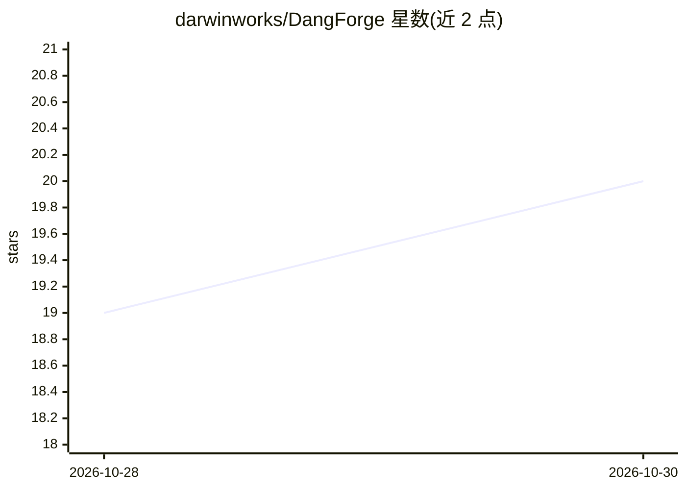

# darwinworks/DangForge

⭐ 20 · MIT · 推送 2026-07-13 · [GitHub](https://github.com/darwinworks/DangForge) · 个人维护 · 中文 README

**把 MR Dang 价值投资框架整理成 AI Agent 可执行的股票分析技能**

以中文技能形式封装 MR Dang《价值投资功法》的投资分析流程：要求 AI 在分析股票前先拉取最新数据，交叉核验公告/财报/研报，检查商业模式、前瞻估值（悲观/中性/乐观三档）、预期股息率、仓位纪律与风险证伪条件。面向 Claude Code、Codex、Cursor Agent 等能读取 GitHub 的 Agent 用户，把仓库链接发给 Agent 即可安装；另推荐 MuseAI 云端方式供非程序员使用。README 明确声明不构成投资建议、不荐股、不预测涨跌。

## 筛选速览

| 维度 | 判定 | 备注 |
|---|---|---|
| AI 角色 | `ai-knowledge` | 知识聚合/清单类 |
| 许可风险 | `permissive` | MIT |
| 部署形态 | `None` |  |
| 模型依赖 | — | README 未给出锁定关系 |
| 硬件要求 | — | 无带数字的原话,不猜 |
| 安装摩擦 | `low` | 无编译、无系统依赖或容器化 |
| 成熟度 | — | 结构信号不足 |

## 能力要点

- 将价值投资框架转写为 Agent 可执行的分析流程（数据核验→商业模式→前瞻估值→仓位纪律→风险证伪）
- 支持个股/行业/银行股/高股息/资源周期股/组合仓位等分析对象
- 兼容 Claude Code、Codex、Cursor Agent 等能读取 GitHub 的 Agent

## 适用场景

- 让 AI Agent 按固定功法流程核验数据后分析个股或行业
- 生成悲观/中性/乐观三档前瞻估值与仓位纪律方案
- 非程序员通过 MuseAI 云端使用该技能免配环境

## 场景标签

`金融量化` · 领域:学习与行业

## 证据(README 行号)

> L3: 把 MR Dang 的《价值投资功法》，整理成 AI Agent 可以执行的中文投资分析流程。
> L20: 如果你已经在用 Claude Code、Codex、Cursor Agent 或其他能读取 GitHub 的 Agent，把这个仓库链接发给它即可：

## 星数曲线

2026-10-28 19 → 2026-10-30 20（+1）

---
*卡片 v1 · prompt 1.4 · 生成 2026-10-28 · 置信度 mid · 依据 README sha `0cad8262fb66` · [字段定义](../../DATASET.md)*
