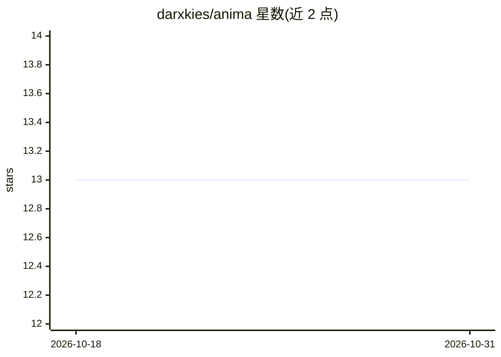

# darxkies/anima

⭐ 13 · Rust · LGPL-2.1 · 推送 2026-03-22 · [GitHub](https://github.com/darxkies/anima) · 个人维护

**持续读新闻并演化情绪状态的持久化 AI 角色实验**

Rust 编写的实验性项目：以小语言模型驱动的持久化角色持续读取 RSS 世界新闻，文章经嵌入后作为记忆存储；每轮对话后由第二次 LLM 提取更新 13 维心理状态（情绪、压力、认知负荷等），状态驱动白日梦/反刍/自省/闯入念头四种空闲内心活动。记忆检索采用 BM25+余弦相似度+RRF 融合+可选重排的 RAG 流水线。支持接入任意 MCP 服务器与 SKILL.md 技能，提供 Leptos Web UI。需自建 llama.cpp 服务器（生成/嵌入/可选重排），作者声明非生产工具且对情绪影响不担责。

## 筛选速览

| 维度 | 判定 | 备注 |
|---|---|---|
| AI 角色 | `ai-native` | 本体是模型或模型工具 |
| 许可风险 | `viral` | LGPL-2.1 |
| 部署形态 | `library` | 以包/库形式分发 |
| 模型依赖 | local-ok | 支持本地模型 |
| 硬件要求 | — | 无带数字的原话,不猜 |
| 安装摩擦 | `low` | 无编译、无系统依赖或容器化 |
| 成熟度 | `idea` | |

## 能力要点

- RSS 新闻流水线：轮询、去重、静默嵌入存储为记忆
- 13 维心理状态由 LLM 提取、跨重启持久化并驱动空闲行为
- BM25+余弦+RRF+可选 cross-encoder 重排的多阶段记忆检索
- 可接入任意数量 MCP 服务器（stdio / Streamable HTTP）与运行时可安装的 SKILL.md 技能

## 适用场景

- 观察一个情绪随世界新闻实时演化的 AI 角色
- 搭建带长期记忆与心理状态模拟的对话伙伴
- 实验 RAG 记忆检索与 MCP 工具调用在持久角色上的组合

## 场景标签

`Agent 记忆` `RAG` `聊天机器人` · 领域:Agent 开发

## 证据(README 行号)

> L11: It does this by running a small language model as a persistent character with a detailed internal state — emotion, 
> L21: - Polls multiple RSS feeds on a configurable interval

## 星数曲线

2026-10-18 13 → 2026-10-31 13（+0）

---
*卡片 v1 · prompt 1.4 · 生成 2026-10-31 · 置信度 high · 依据 README sha `b7aff1b83d41` · [字段定义](../../DATASET.md)*
