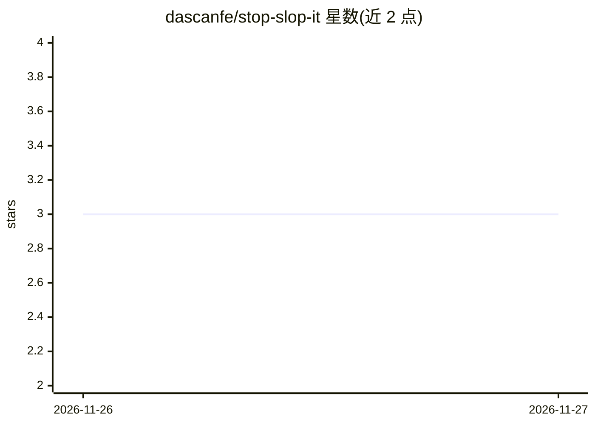

# dascanfe/stop-slop-it

⭐ 3 · MIT · 推送 2026-11-05 · [GitHub](https://github.com/dascanfe/stop-slop-it) · 个人维护

**面向意大利语写作者的 Claude Skill：去除文本中的 AI 腔调**

stop-slop 的意大利语改编版，以 Agent Skills 标准格式的技能包形式提供：SKILL.md 含 9 条改写规则与五维 1-10 打分体系（总分低于 35/50 判定需重写），references/ 目录存放按家族分类的表达清单、句式结构与改写示例，仅在需要时读取以保持轻量。目标用户为用意大利语写作并希望消除 AI 模式化文本的人。通过 npx 安装到 Claude Code、Cursor、GitHub Copilot 等 Agent Skills 兼容助手，也可克隆到个人技能目录或上传 ZIP 到 Claude.ai；Enterprise 计划需管理员启用代码执行。

## 筛选速览

| 维度 | 判定 | 备注 |
|---|---|---|
| AI 角色 | `ai-native` | 本体是模型或模型工具 |
| 许可风险 | `permissive` | MIT |
| 部署形态 | `library` | 以包/库形式分发 |
| 模型依赖 | — | README 未给出锁定关系 |
| 硬件要求 | — | 无带数字的原话,不猜 |
| 安装摩擦 | `low` | 无编译、无系统依赖或容器化 |
| 成熟度 | — | 结构信号不足 |

## 能力要点

- 9 条改写规则 + 五维打分（总分 50，低于 35 需重写）
- 针对意大利语特有模式：无人称 si、名词化、英语仿译
- 兼容 Agent Skills 标准（Claude Code/Cursor/Copilot/ChatGPT 等）
- references/ 文件按需读取，保持技能轻量

## 适用场景

- 润色意大利语文案，去除 AI 生成痕迹
- 在 Claude Code 中用 /stop-slop-it 审查并打分文本
- 团队协作中统一意大利语文风规范

## 场景标签

`AI 写作` · 领域:内容生成

## 证据(README 行号)

> L5: Versione italiana di stop-slop. Funziona con Claude e con gli altri assistenti compatibili con lo standard Agent Ski
> L56: Ogni testo riceve anche un punteggio da 1 a 10 su cinque dimensioni (direzione, ritmo, fiducia, autenticità, densit

## 星数曲线

2026-11-26 3 → 2026-11-27 3（+0）

---
*卡片 v1 · prompt 1.4 · 生成 2026-11-26 · 置信度 high · 依据 README sha `cea180539ca7` · [字段定义](../../DATASET.md)*
