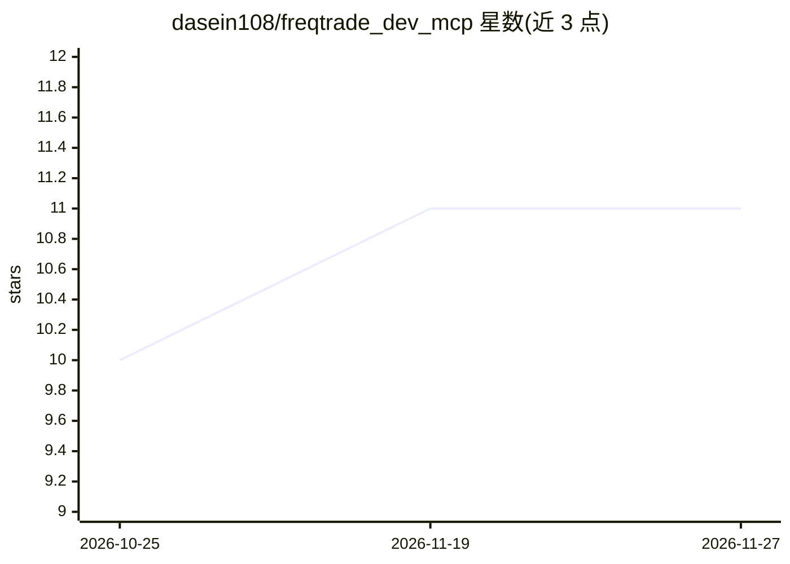

# dasein108/freqtrade_dev_mcp

⭐ 11 · Python · MIT · 推送 2026-09-22 · [GitHub](https://github.com/dasein108/freqtrade_dev_mcp) · 个人维护

**把 Freqtrade 回测/调参工具通过 MCP 暴露给 LLM 客户端**

一个 stdio MCP server，将 Freqtrade 的数据下载、回测、hyperopt 与结果分析封装为 12 个工具，供 Claude Desktop、Claude Code 等 MCP 客户端以自然语言调用；附带一个 LangGraph agent，按「构思→写策略→hyperopt→回测→分析→重写」的循环自动生成并优化交易策略。依赖已安装的 Freqtrade（Python 3.11+）及其 user_data 目录，结果索引存于 SQLite。README 声明项目处于 alpha 状态、独立于 Freqtrade 团队，仅供研究与教育，不预测实盘表现。

## 筛选速览

| 维度 | 判定 | 备注 |
|---|---|---|
| AI 角色 | `ai-ecosystem` | LLM/agent 周边工具 |
| 许可风险 | `permissive` | MIT |
| 部署形态 | `library` | 以包/库形式分发 |
| 模型依赖 | locked-api |  |
| 硬件要求 | — | 无带数字的原话,不猜 |
| 安装摩擦 | `medium` | 含编译或系统依赖之一 |
| 成熟度 | `idea` | |

## 能力要点

- 12 个 MCP 工具覆盖数据下载、回测、hyperopt 与结果解析（SQLite 结果索引）
- LangGraph agent 无人值守运行策略生成-优化-评估完整循环
- 支持自然语言时间范围（如 last 3 months）与 CoinGecko top15 数据下载
- 文件写入工具限制路径在 FREQTRADE_MCP_PATH 之内

## 适用场景

- 在 Claude Desktop 中用对话方式运行 Freqtrade 回测并分析结果
- 让 agent 自动迭代生成和调优交易策略（walk-forward 验证防过拟合）
- 批量解析回测 zip 与 .fthypt 文件，按收益/回撤/胜率筛选结果

## 场景标签

`编码 Agent` `金融量化` · 领域:编码与开发

## 证据(README 行号)

> L3: MCP server that exposes Freqtrade strategy development tools (data download, backtesting, hyperopt, result analysis)
> L15: |MCP server|`src/`|stdio MCP server with 12 Freqtrade tools|
> L16: |Strategy agent|`strategy_agent/`|LangGraph workflow: idea → code → hyperopt → backtest → analysis → rewrite|

## 星数曲线

2026-10-25 10 → 2026-11-27 11（+1）

---
*卡片 v1 · prompt 1.4 · 生成 2026-11-19 · 置信度 high · 依据 README sha `eb02e544c38f` · [字段定义](../../DATASET.md)*
