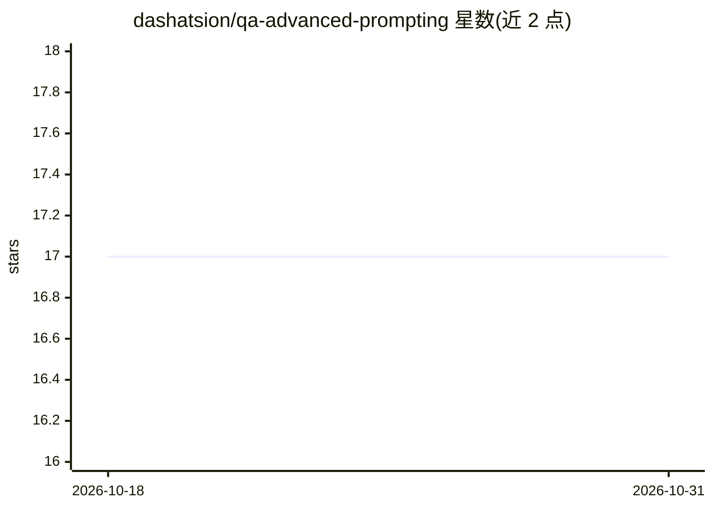

# dashatsion/qa-advanced-prompting

⭐ 17 · MIT · 推送 2026-01-20 · [GitHub](https://github.com/dashatsion/qa-advanced-prompting) · [官网](https://dev.to/dashatsion) · 个人维护

**自动化 QA 的提示词库：面向 Cypress/Playwright/API 测试**

由 Dasha Tsion 维护的 QA 提示词工程仓库：提供 10+ 条面向自动化测试工作流的高级提示词，覆盖测试设计、flaky 分析、重构、数据生成与报告场景，配套以 Cypress 为主的可复制示例及 issue 模板。使用方式为将提示词粘贴到 ChatGPT、Claude、Gemini 等 AI 工具，加入项目上下文后迭代生成测试产物。定位为可纳入 CI/CD 与代码评审流程的可复用提示词资产，非代码库或框架。

## 筛选速览

| 维度 | 判定 | 备注 |
|---|---|---|
| AI 角色 | `ai-knowledge` | 知识聚合/清单类 |
| 许可风险 | `permissive` | MIT |
| 部署形态 | `None` |  |
| 模型依赖 | — | README 未给出锁定关系 |
| 硬件要求 | — | 无带数字的原话,不猜 |
| 安装摩擦 | `low` | 无编译、无系统依赖或容器化 |
| 成熟度 | — | 结构信号不足 |

## 能力要点

- 10+ 条自动化 QA 高级提示词（测试设计/flaky 分析/重构/数据生成/报告）
- Cypress 为主的复制即用示例目录
- 提示词可在 ChatGPT/Claude/Gemini 间通用

## 适用场景

- 生成或重构 Cypress/Playwright 自动化测试用例
- 分析 flaky 测试并生成修复建议
- 为 API 测试与测试报告编写复用提示词

## 场景标签

`提示工程` · 领域:Agent 开发

## 证据(README 行号)

> L12: This repository hosts a practical **QA Prompt Library** focused on automation workflows (Cypress/Playwright/API), p
> L17: - `prompts/QA_Prompt_Library.md` — 10+ advanced prompts for automation QA (test design, flaky analysis, refactoring

## 星数曲线

2026-10-18 17 → 2026-10-31 17（+0）

---
*卡片 v1 · prompt 1.4 · 生成 2026-10-29 · 置信度 high · 依据 README sha `04420f317926` · [字段定义](../../DATASET.md)*
