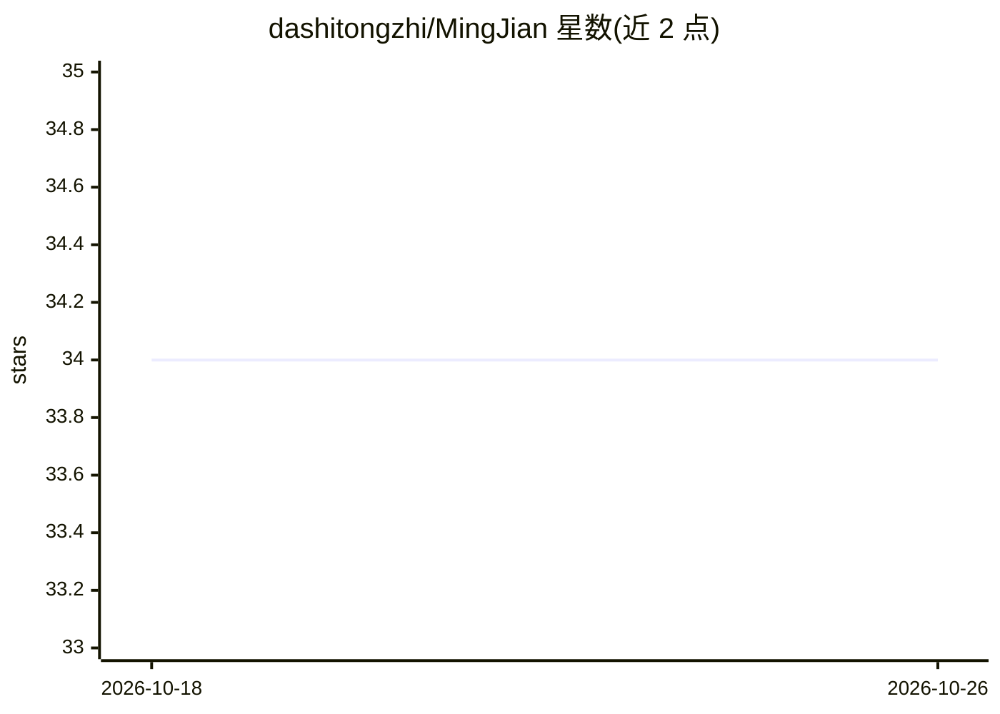

# dashitongzhi/MingJian

⭐ 34 · Python · Apache-2.0 · 推送 2026-08-11 · [GitHub](https://github.com/dashitongzhi/MingJian) · 组织维护 · 中文 README

**多智能体决策支持平台：证据采集、辩论与情景仿真生成可审计建议**

面向创始人、分析师、战略与军事规划人员的战略情报工作台：用户提交决策请求后，系统从多源采集证据、抽取声明，由 9 个角色化智能体（支持方/挑战方/仲裁官加 6 个视角角色）多轮辩论，输出带确定性决策轨迹的版本化建议，并支持 WatchRule 24 小时本地监控与定时刷新。双领域支持企业与军事仿真。模型槽位全部走 OpenAI 兼容端点，可混用 OpenAI/Anthropic/DeepSeek/Gemini/Grok/智谱等。社区版 Apache 2.0 自托管，监控窗口限 24 小时，长时监控归云端/企业版。提供 Docker 一键脚本与手动开发部署两条路径。

## 筛选速览

| 维度 | 判定 | 备注 |
|---|---|---|
| AI 角色 | `ai-native` | 本体是模型或模型工具 |
| 许可风险 | `permissive` | Apache-2.0 |
| 部署形态 | `self-host` | docker 或自建部署 |
| 模型依赖 | locked-api |  |
| 硬件要求 | — | 无带数字的原话,不猜 |
| 安装摩擦 | `low` | 无编译、无系统依赖或容器化 |
| 成熟度 | — | 结构信号不足 |

## 能力要点

- 9 智能体辩论理事会（核心 3 角色常驻 + 6 视角角色按需激活）
- 10+ 数据源证据链，每条建议可溯源、决策轨迹确定性可回放
- 企业/军事双领域仿真、场景分支与 KPI 追踪
- 模型槽位统一 OpenAI 兼容端点，单一 API key 即可启动全部 7 个槽位

## 适用场景

- 投资研究：多源证据支持与挑战方辩论投资假设
- 企业战略：竞争情报与情景规划的可审计建议
- 军事规划：作战分析与后勤优化的多视角评估
- 政策/风险分析：多利益相关方影响评估

## 场景标签

`多智能体` · 领域:Agent 开发

## 证据(README 行号)

> L5: **An open-source strategic intelligence cockpit for evidence-grounded decisions, multi-agent debate, scenario simula
> L34: The product experience is closer to a strategic intelligence cockpit than a chat box. A user submits a decision-sup
> L116: **Our Solution:** 明鉴 deploys **9 specialized AI agents** — each with a distinct role, perspective, and model — to 

## 星数曲线

2026-10-18 34 → 2026-10-26 34（+0）

---
*卡片 v1 · prompt 1.4 · 生成 2026-10-25 · 置信度 mid · 依据 README sha `5beb50202f1d` · [字段定义](../../DATASET.md)*
