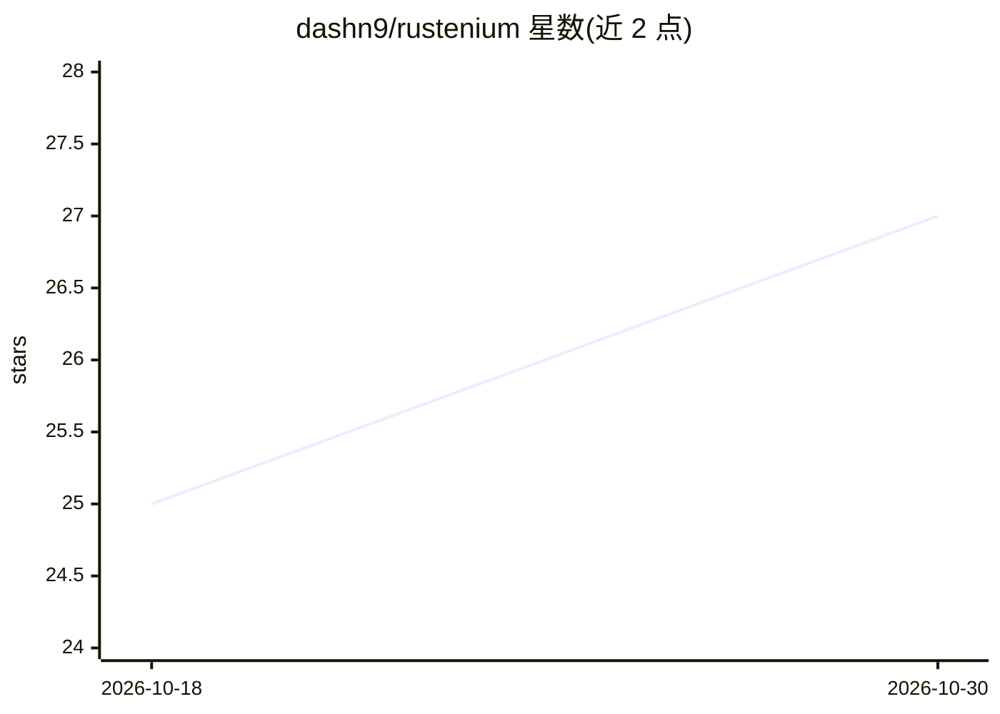

# dashn9/rustenium

⭐ 27 · Rust · MIT · 推送 2026-10-25 · [GitHub](https://github.com/dashn9/rustenium) · 个人维护

**Rust 多协议浏览器自动化库：同时支持 WebDriver BiDi 与 CDP**

面向 Rust 开发者的浏览器自动化库，基于 WebDriver BiDi 与 Chrome DevTools Protocol 双协议，可独立或组合使用。支持 Chrome/Chromium 与 Firefox（Firefox 仅 BiDi，无 CDP），浏览器与 chromedriver 缺失时可自动下载。提供精确与拟人鼠标输入、键盘、触摸屏、CSS/XPath 选择器宏、网络拦截、事件订阅、脚本注入、时区与设备模拟等能力，分为六个 crate。要求 Rust 1.85+ 与 Chrome 或 Firefox。

## 筛选速览

| 维度 | 判定 | 备注 |
|---|---|---|
| AI 角色 | `ai-ecosystem` | LLM/agent 周边工具 |
| 许可风险 | `permissive` | MIT |
| 部署形态 | `None` |  |
| 模型依赖 | — | README 未给出锁定关系 |
| 硬件要求 | — | 无带数字的原话,不猜 |
| 安装摩擦 | `low` | 无编译、无系统依赖或容器化 |
| 成熟度 | — | 结构信号不足 |

## 能力要点

- WebDriver BiDi 与 CDP 双协议，可独立或运行时组合连接
- Chrome 与 Firefox 支持，浏览器及 chromedriver 自动下载
- 拟人鼠标轨迹（贝塞尔曲线与抖动）与精确鼠标输入
- 协议无关的网络请求拦截 API 与实时事件订阅

## 适用场景

- 在 Rust 项目中编写浏览器自动化与端到端测试
- 监控和拦截网络请求用于测试或数据采集
- 模拟不同设备指标与时区进行响应式测试

## 场景标签

`浏览器自动化` · 领域:效率与自动化

## 证据(README 行号)

> L5: Rustenium provides a powerful and ergonomic API for browser automation using the WebDriver BiDi and Chrome DevTools 
> L7: Like Puppeteer / Playwright, but for RUST.

## 星数曲线

2026-10-18 25 → 2026-10-30 27（+2）

---
*卡片 v1 · prompt 1.4 · 生成 2026-10-27 · 置信度 high · 依据 README sha `09b93058c012` · [字段定义](../../DATASET.md)*
