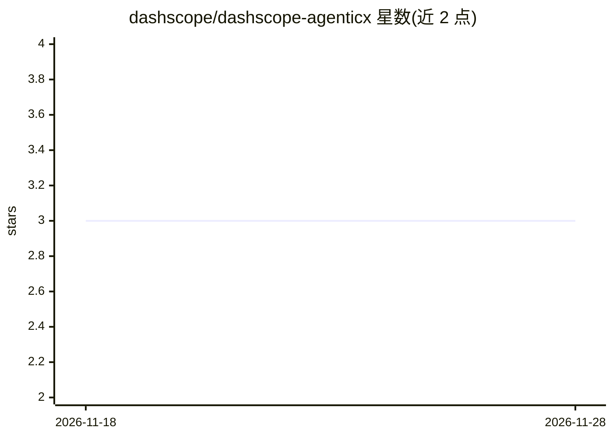

# dashscope/dashscope-agenticx

⭐ 3 · Python · 推送 2026-11-19 · [GitHub](https://github.com/dashscope/dashscope-agenticx) · [官网](https://dashscope.github.io/dashscope-agenticx/) · 组织维护 · 中文 README

**面向开发者的 Python Agent 运行时：构建并运行领域专家应用**

AgenticX 1.0 是用于构建和运行领域专家的 Python Agent Runtime：在单一运行时中连接模型调用、工具协调、Skill、权限策略与会话持久化，提供 CLI、Textual TUI、Python SDK 与令牌认证的本地 Server 接口。支持以本地助手使用、嵌入 Python 应用，或将领域专家打包为带版本清单与校验和的 App Bundle 分发安装。权限检查、confirm 模式与可选 OS 沙箱构成执行边界；非托管服务，非操作系统级沙箱。需 Python 3.10+ 与 API key。

## 筛选速览

| 维度 | 判定 | 备注 |
|---|---|---|
| AI 角色 | `ai-ecosystem` | LLM/agent 周边工具 |
| 许可风险 | `none` | — |
| 部署形态 | `library` | 以包/库形式分发 |
| 模型依赖 | — | README 未给出锁定关系 |
| 硬件要求 | — | 无带数字的原话,不猜 |
| 安装摩擦 | `low` | 无编译、无系统依赖或容器化 |
| 成熟度 | — | 结构信号不足 |

## 能力要点

- 统一运行时：工具、Skill、hook、权限与会话持久化
- CLI、TUI、Python SDK 与令牌认证的本地 Server 多接口
- App Bundle：版本化清单、权限 diff、校验和验证与应用管理命令
- 类型化 AgentEventEnvelope 事件流供应用集成

## 适用场景

- 将领域专家打包为 App Bundle 在团队内分发安装
- 在 Python 应用中嵌入带工具执行能力的 agent
- 作为本地终端助手执行文件查看、项目分析等任务

## 场景标签

`Agent 框架` · 领域:Agent 开发

## 证据(README 行号)

> L9: AgenticX 1.0 is a Python Agent Runtime for building and running domain experts.
> L25: |Interfaces|CLI, Textual TUI, Python SDK, embedded entry points, and a token-authenticated localhost Server|
> L26: |Model access|Tongyi/DashScope, plus optional provider SDKs and declarative provider configuration|

## 星数曲线

2026-11-18 3 → 2026-11-28 3（+0）

---
*卡片 v1 · prompt 1.4 · 生成 2026-11-22 · 置信度 high · 依据 README sha `729a8e6a839e` · [字段定义](../../DATASET.md)*
