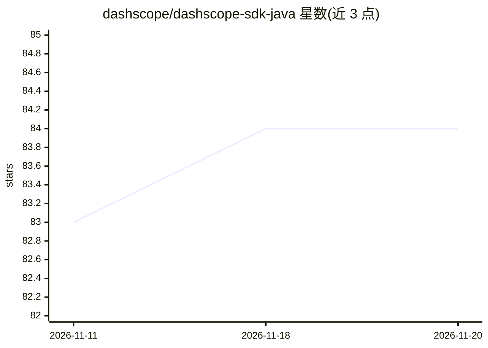

# dashscope/dashscope-sdk-java

⭐ 84 · Java · Apache-2.0 · 推送 2026-11-19 · [GitHub](https://github.com/dashscope/dashscope-sdk-java) · [官网](https://modelstudio.console.alibabacloud.com/) · 组织维护 · 中文 README

**阿里云百炼 DashScope 模型的 Java SDK**

面向 Java 开发者的 DashScope 模型服务官方 SDK：通过 Maven 依赖引入，提供文本生成（流式/非流式，支持回调与 reactive io 接收）与决策模型（批量选择题/是非题/量表题，不支持流式）等 API 封装。API key 默认从 DASHSCOPE_API_KEY 环境变量读取。决策模型端点按 workspace 划分，构造客户端时必须传 workspace id 否则抛 IllegalArgumentException，region 默认 cn-beijing。

## 筛选速览

| 维度 | 判定 | 备注 |
|---|---|---|
| AI 角色 | `ai-ecosystem` | LLM/agent 周边工具 |
| 许可风险 | `permissive` | Apache-2.0 |
| 部署形态 | `None` |  |
| 模型依赖 | — | README 未给出锁定关系 |
| 硬件要求 | — | 无带数字的原话,不猜 |
| 安装摩擦 | `low` | 无编译、无系统依赖或容器化 |
| 成熟度 | — | 结构信号不足 |

## 能力要点

- Generation 接口支持流式/非流式查询，可通过回调或 Flowable 接收
- DecisionModel 针对业务状态批量回答选择/是非/量表类问题
- 支持通过 DASHSCOPE_DECISION_BASE_URL / withBaseUrl 自定义端点
- Maven 依赖引入，API key 与 workspace 通过环境变量或显式设置

## 适用场景

- 在 Java 系统中调用通义千问等 DashScope 模型
- 以流式或 reactive 方式接收生成结果
- 构建基于决策模型的批量问答业务逻辑

## 场景标签

 · 领域:LLM 基础设施/云服务 SDK

## 证据(README 行号)

> L3: This is the java sdk for the DashScope models.
> L7: To use the sdk in your java systems, please add the maven dependency in your pom.xml:

## 星数曲线

2026-11-11 83 → 2026-11-20 84（+1）

---
*卡片 v1 · prompt 1.4 · 生成 2026-11-18 · 置信度 high · 依据 README sha `405b1db6c9c6` · [字段定义](../../DATASET.md)*
