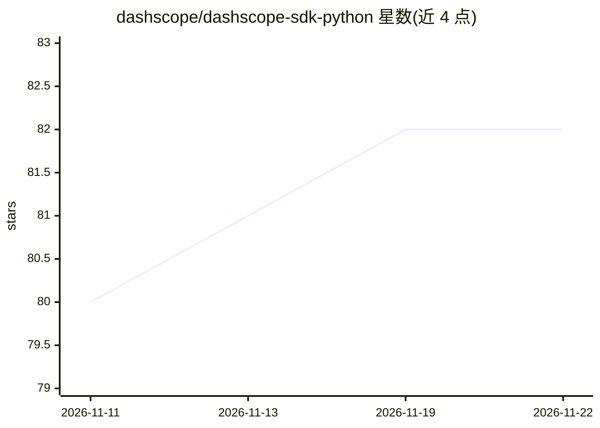

# dashscope/dashscope-sdk-python

⭐ 82 · Python · Apache-2.0 · 推送 2026-11-20 · [GitHub](https://github.com/dashscope/dashscope-sdk-python) · [官网](https://dashscope.github.io/dashscope-sdk-python/) · 组织维护 · 中文 README

**阿里云百炼 DashScope 官方 Python SDK，调用各类模型 API**

面向开发者的阿里云模型服务官方客户端，覆盖文本生成、多模态、embedding、reranking、图像/视频生成、语音合成与识别、微调、Agentic RL 与应用 API。2.0 版本引入资源式客户端 dashscope.Client()，共享连接池、类型化响应、默认抛出类型化异常，并支持 native/openai/anthropic 三种协议；1.x 公共接口保留在 legacy_1x 门面下。要求 Python 3.9+，可选 acli 系列附加组件提供 SDK 专家 AI 助手（需 3.10+）。2.0 错误接口声明仍在演进。

## 筛选速览

| 维度 | 判定 | 备注 |
|---|---|---|
| AI 角色 | `ai-ecosystem` | LLM/agent 周边工具 |
| 许可风险 | `permissive` | Apache-2.0 |
| 部署形态 | `library` | 以包/库形式分发 |
| 模型依赖 | — | README 未给出锁定关系 |
| 硬件要求 | — | 无带数字的原话,不猜 |
| 安装摩擦 | `low` | 无编译、无系统依赖或容器化 |
| 成熟度 | `idea` | |

## 能力要点

- 资源式 Client：chat/images/audio 等能力以类型化资源挂载
- 一个客户端支持 native/openai/anthropic 三种协议切换
- 同步/异步双客户端，类型化 DashScopeError 异常体系
- 可选 acli 附加组件提供交互式 AI 助手（支持语音/相机输入）

## 适用场景

- 在 Python 应用中调用通义千问等 DashScope 模型
- 把现有 OpenAI 或 Anthropic 代码迁移到 DashScope 后端
- 集成语音识别/合成、图像视频生成与微调 API

## 场景标签

`模型网关` · 领域:Agent 开发

## 证据(README 行号)

> L5: The DashScope Python SDK is the official client for Alibaba Cloud Model Studio (Bailian), covering text generation, 
> L7: **Version 2.0** introduces a resource-style client — `dashscope.Client()` — modeled on the ergonomics of the OpenAI 

## 星数曲线

2026-11-11 80 → 2026-11-22 82（+2）

---
*卡片 v1 · prompt 1.4 · 生成 2026-11-18 · 置信度 high · 依据 README sha `8c536799bae9` · [字段定义](../../DATASET.md)*
