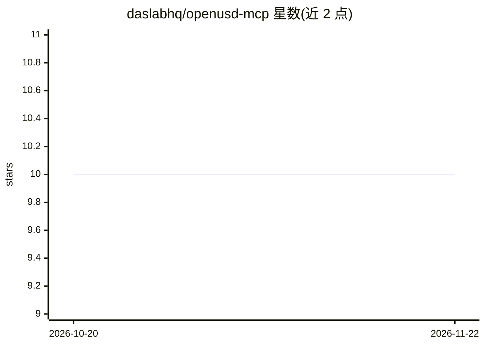

# daslabhq/openusd-mcp

⭐ 10 · Python · MIT · 推送 2026-05-03 · [GitHub](https://github.com/daslabhq/openusd-mcp) · 组织维护

**MCP 服务器：让 AI 助手读取、检查与操作 OpenUSD 3D 场景**

以 MCP 协议（stdin/stdout）提供服务的服务器，连接 Claude Desktop、ChatGPT、Cursor 等 MCP 客户端后，AI 助手可直接处理 .usda/.usdc/.usdz 文件：读取场景图与 prim 属性、列出材质与变换、切换变体、导出 STL/OBJ 网格、统计场景信息，共 8 个工具。基于 Pixar 官方 pxr Python 绑定（usd-core）实现，附带两个示例场景与交互式 3D 查看器演示。Python 3.9+ 环境运行，MIT 许可。

## 筛选速览

| 维度 | 判定 | 备注 |
|---|---|---|
| AI 角色 | `ai-ecosystem` | LLM/agent 周边工具 |
| 许可风险 | `permissive` | MIT |
| 部署形态 | `library` | 以包/库形式分发 |
| 模型依赖 | — | README 未给出锁定关系 |
| 硬件要求 | — | 无带数字的原话,不猜 |
| 安装摩擦 | `low` | 无编译、无系统依赖或容器化 |
| 成熟度 | — | 结构信号不足 |

## 能力要点

- 8 个 MCP 工具覆盖场景图检查、材质查询、变体切换与网格导出
- 支持 .usda/.usdc/.usdz 三种 USD 文件格式
- 基于 Pixar 官方 pxr Python 绑定读取与操作 USD stage
- 附带两个示例场景及交互式 3D 查看器在线演示

## 适用场景

- 让 Claude 检查 USD 场景图并描述场景内容
- 通过对话切换产品配置器中的尺寸/颜色/表面变体
- 将场景中的网格 prim 导出为 STL 或 OBJ

## 场景标签

 · 领域:3D 场景工具/MCP 基础设施

## 证据(README 行号)

> L3: An MCP server that lets AI assistants read, inspect, and manipulate OpenUSD scenes.
> L13: Connect this MCP server to Claude, ChatGPT, Cursor, or any MCP-compatible client. Your AI assistant can then work d
> L53: The server communicates over stdin/stdout using the MCP protocol.

## 星数曲线

2026-10-20 10 → 2026-11-22 10（+0）

---
*卡片 v1 · prompt 1.4 · 生成 2026-11-19 · 置信度 high · 依据 README sha `b5a3a033d446` · [字段定义](../../DATASET.md)*
