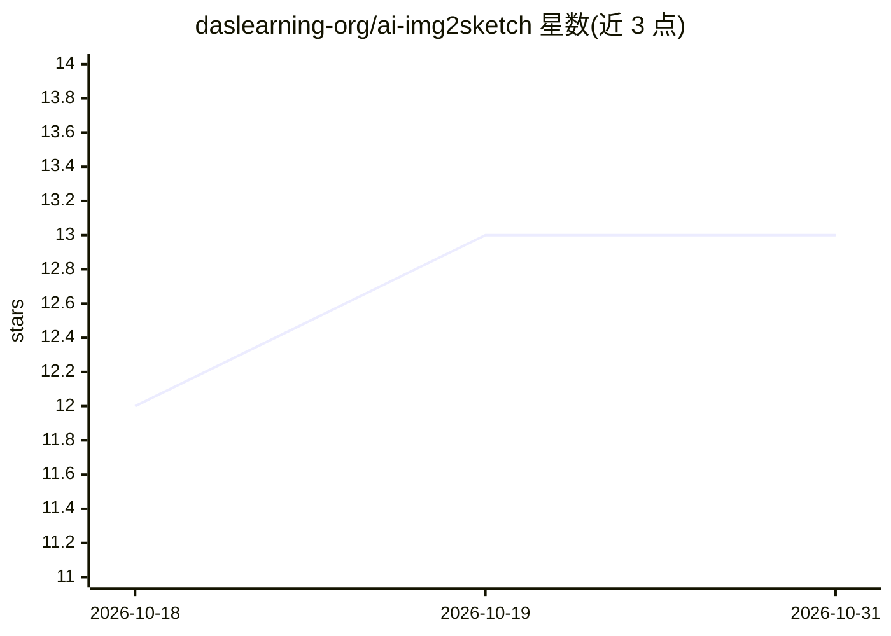

# daslearning-org/ai-img2sketch

⭐ 13 · Python · MIT · 推送 2025-12-02 · [GitHub](https://github.com/daslearning-org/ai-img2sketch) · [官网](https://daslearning.in) · 个人维护

**上传图片生成白板手绘动画视频的 Gradio 应用**

基于 Gradio 的网页应用：用户上传图片后生成白板手绘风格的动画视频。实现依赖 NumPy 与 OpenCV 的图像处理，不使用预训练 AI 模型，CPU 即可运行。提供自动与手动两种安装方式（git clone + pip 安装依赖），运行 img2SketchUI.py 启动。已知问题为默认 mp4v 编码在浏览器可能不兼容，需安装 ffmpeg 相关包转换；后续计划增加 GPU 支持与分辨率自定义。README 顶部声明项目已迁移为独立桌面/移动应用。

## 筛选速览

| 维度 | 判定 | 备注 |
|---|---|---|
| AI 角色 | `ai-native` | 本体是模型或模型工具 |
| 许可风险 | `permissive` | MIT |
| 部署形态 | `library` | 以包/库形式分发 |
| 模型依赖 | — | README 未给出锁定关系 |
| 硬件要求 | — | 无带数字的原话,不猜 |
| 安装摩擦 | `medium` | 含编译或系统依赖之一 |
| 成熟度 | — | 结构信号不足 |

## 能力要点

- 上传图片一键生成白板手绘动画视频
- 基于 NumPy/OpenCV，无需预训练模型，CPU 运行
- 提供 Gradio 网页 UI
- README 声明项目已迁移为 Android/Windows/Linux 独立应用

## 适用场景

- 把照片转成手绘动画视频用于教学或演示
- 无需 GPU 与模型下载的本地图像转视频处理

## 场景标签

`图像视频处理` · 领域:感知与多模态

## 证据(README 行号)

> L4: # 📷 Image to WhiteBoard Sketch Animation Video Generation
> L5: Simply upload your image and see the magic after clicking the `Submit` button. This do not require any fancy pre-tra

## 星数曲线

2026-10-18 12 → 2026-10-31 13（+1）

---
*卡片 v1 · prompt 1.4 · 生成 2026-10-31 · 置信度 low · 依据 README sha `f8fd48d2fa20` · [字段定义](../../DATASET.md)*
