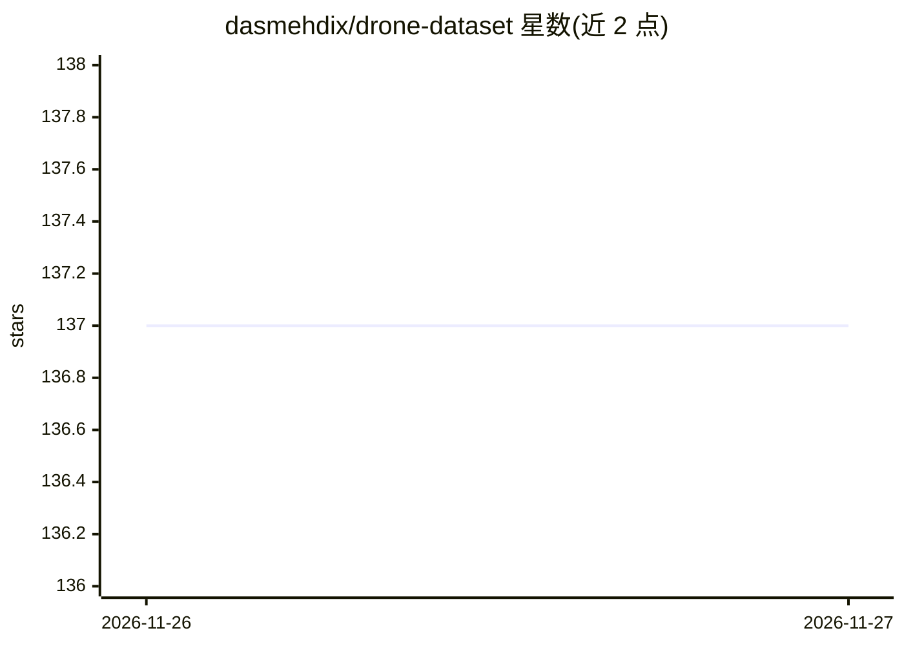

# dasmehdix/drone-dataset

⭐ 137 · JavaScript · MIT · 推送 2026-11-24 · [GitHub](https://github.com/dasmehdix/drone-dataset) · 个人维护

**面向无人机检测任务的无人机图像标注数据集及配套工具**

约 1400 张无人机图像及标注文件的开放数据集，标注同时提供 .txt 与 .xml 两种格式，可分别配合 YOLO（Darknet/PyTorch）与 Tensorflow 使用。图像来源为 Google/Yandex 图片搜索抓取及 YouTube 无人机视频裁剪，自报 86% mAP。附带两个辅助脚本：xmlparser 用于修正 LabelImg 标注文件中的路径问题，txt_path_generator_yolo 用于生成 YOLO-v3 训练所需的图片路径清单。数据集已在 Zenodo 归档并获得 DOI。

## 筛选速览

| 维度 | 判定 | 备注 |
|---|---|---|
| AI 角色 | `ai-knowledge` | 知识聚合/清单类 |
| 许可风险 | `permissive` | MIT |
| 部署形态 | `None` |  |
| 模型依赖 | — | README 未给出锁定关系 |
| 硬件要求 | — | 无带数字的原话,不猜 |
| 安装摩擦 | `low` | 无编译、无系统依赖或容器化 |
| 成熟度 | — | 结构信号不足 |

## 能力要点

- 约 1400 张无人机图像及标注，含 .txt 与 .xml 双格式标签
- 附 xmlparser 脚本修正 LabelImg 标注文件路径问题
- 附 txt_path_generator_yolo 脚本生成 YOLO-v3 训练路径清单
- Zenodo 归档并具有 DOI，可直接引用

## 适用场景

- 为无人机检测模型训练准备标注数据
- 复现 YOLO 系列在无人机检测上的训练实验
- 学术研究或竞赛中引用该数据集

## 场景标签

`目标检测` · 领域:感知与多模态

## 证据(README 行号)

> L4: This dataset prepared for academical and competition purpose. Main idea of this dataset is to guide our drone to oth
> L41: This dataset is now officially archived on Zenodo and has a permanent Digital Object Identifier (DOI).

## 星数曲线

2026-11-26 137 → 2026-11-27 137（+0）

---
*卡片 v1 · prompt 1.4 · 生成 2026-11-26 · 置信度 high · 依据 README sha `09017b8b6eed` · [字段定义](../../DATASET.md)*
