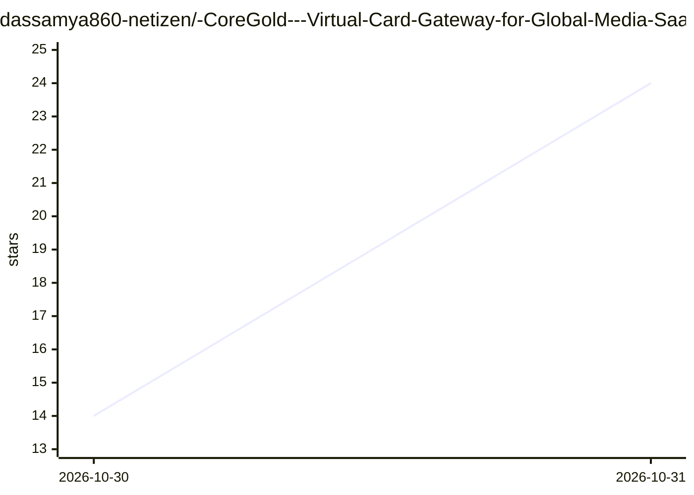

# dassamya860-netizen/-CoreGold---Virtual-Card-Gateway-for-Global-Media-SaaS

⭐ 24 · 推送 2026-10-28 · [GitHub](https://github.com/dassamya860-netizen/-CoreGold---Virtual-Card-Gateway-for-Global-Media-SaaS) · [官网](https://app.coregold.io/signup?invite_code=ADvlj9b) · 组织维护 · 中文 README

**面向出海企业的 Visa/Mastercard 虚拟卡发卡平台**

商业虚拟信用卡（VCC）服务：宣称直连海外银行清算网关，提供 USDT 充值自动兑换美元额度、无上限生成独立虚拟卡（独立卡号/有效期/CVV）、单卡商户指纹锁定、单笔与月度限额、余额注销后毫秒级退回等功能。面向跨境广告投放、独立站运营与海外软件订阅的企业用户，通过注册控制台使用，无本地安装环节。README 中的 AI 相关内容仅为其支付场景（为 OpenAI/Anthropic 等订阅付款），产品本身不含 AI 功能。

## 筛选速览

| 维度 | 判定 | 备注 |
|---|---|---|
| AI 角色 | `ai-enhanced` | 去掉 AI 部分产品仍成立 |
| 许可风险 | `none` | — |
| 部署形态 | `None` |  |
| 模型依赖 | — | README 未给出锁定关系 |
| 硬件要求 | — | 无带数字的原话,不猜 |
| 安装摩擦 | `low` | 无编译、无系统依赖或容器化 |
| 成熟度 | — | 结构信号不足 |

## 能力要点

- USDT 链上充值自动兑付为美元可用额度
- 单账户无上限生成独立卡号/有效期/CVV 的虚拟卡
- 单卡商户指纹锁定与单笔/月度限额
- 卡片注销后未消耗额度毫秒级退回母账户

## 适用场景

- 为海外广告平台投放分配独立扣费卡
- 多店铺运营中实现一店一卡的资金隔离
- 为 OpenAI/Anthropic/AWS 等开发者订阅付款

## 场景标签

 · 领域:跨境支付/金融服务

## 证据(README 行号)

> L33: |**AI 算力与开发基础设施**|`OpenAI API`, `Anthropic (Claude)`, `Cursor`, `AWS / GCP`|轻松突破海外开发者订阅的发卡地限制，保障高频开发与模型调用不中断|
> L41: ### 1. 注册管理账户

## 星数曲线

2026-10-30 14 → 2026-10-31 24（+10）

---
*卡片 v1 · prompt 1.4 · 生成 2026-10-30 · 置信度 low · 依据 README sha `c7c96850bb1e` · [字段定义](../../DATASET.md)*
