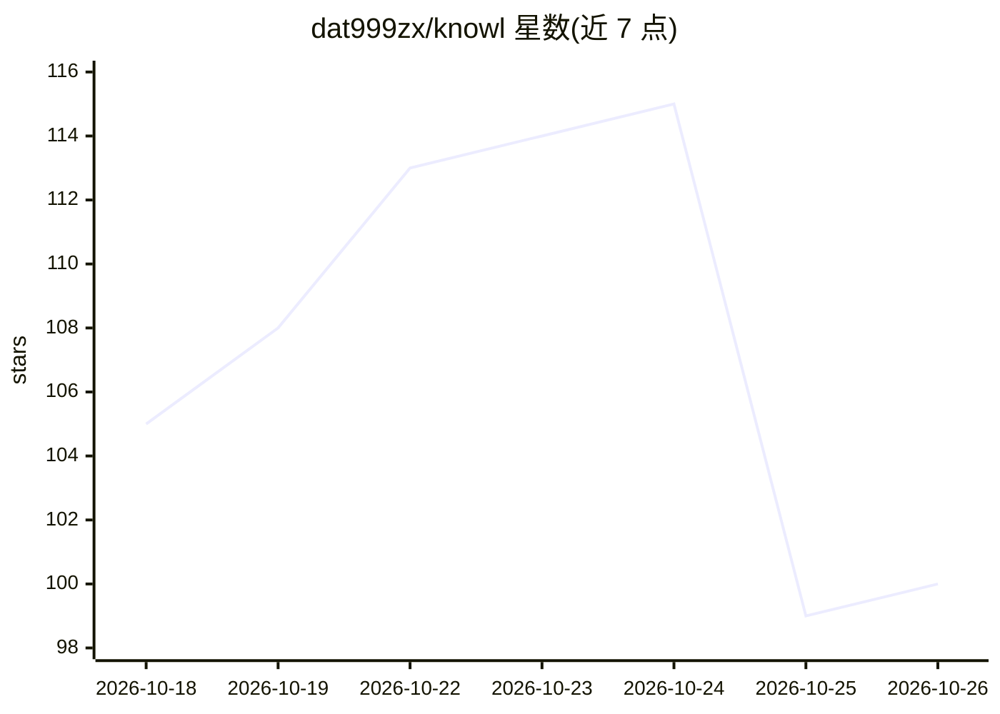

# dat999zx/knowl

⭐ 100 · TypeScript · Apache-2.0 · 推送 2026-10-21 · [GitHub](https://github.com/dat999zx/knowl) · [官网](https://knowl.cloud) · 个人维护

**AI agent 持久记忆系统：事实被取代时自动退役旧条目**

面向 Claude Code、Codex、Cursor 等 agent 的持久记忆层，通过 MCP 或 CLI 提供读写。核心机制是 supersession：同一主题的新事实写入时，旧事实被标记 superseded 并退出常规检索，仍可通过 timeline 查询。数据存本地 SQLite，无需 API key，捆绑 SQLite、tree-sitter 与嵌入运行时（约 53MB 本地嵌入模型）。事实分 7 类，带状态、新鲜度、置信度、来源 commit 与 evidence 指针。支持 14+ 种 agent 宿主接入，提供可选的 knowl.cloud 托管层用于团队共享。README 中 MemoryAgentBench FactConsolidation @262K 得分 90 为自报并声称经该基准自有 harness 复现。

## 筛选速览

| 维度 | 判定 | 备注 |
|---|---|---|
| AI 角色 | `ai-ecosystem` | LLM/agent 周边工具 |
| 许可风险 | `permissive` | Apache-2.0 |
| 部署形态 | `library` | 以包/库形式分发 |
| 模型依赖 | locked-api |  |
| 硬件要求 | — | 无带数字的原话,不猜 |
| 安装摩擦 | `medium` | 含编译或系统依赖之一 |
| 成熟度 | — | 结构信号不足 |

## 能力要点

- supersession 机制：新事实取代旧事实时旧条目自动退役
- 本地 SQLite 存储，无需 API key，28 个 MCP 工具
- 7 类知识原子，含状态/新鲜度/置信度/来源 commit/evidence 字段
- 自动检测并注册到 14+ 种 agent 宿主（MCP/插件/ACP）

## 适用场景

- 替代不断膨胀的 CLAUDE.md，让 agent 记住当前有效的项目决策
- 多 agent 并行工作时通过 git worktree 共享同一记忆库
- 团队通过 knowl.cloud 在多个仓库间共享 agent 知识

## 场景标签

`Agent 记忆` · 领域:Agent 开发

## 证据(README 行号)

> L32: Knowl is persistent memory for AI agents, for code, research and everyday life, over
> L298: `knowl serve` exposes the store over stdio MCP; `knowl init` registers it for you. The workflow the

## 星数曲线

2026-10-18 105 → 2026-10-26 100（-5）

---
*卡片 v1 · prompt 1.4 · 生成 2026-10-23 · 置信度 high · 依据 README sha `e14729e84e72` · [字段定义](../../DATASET.md)*
