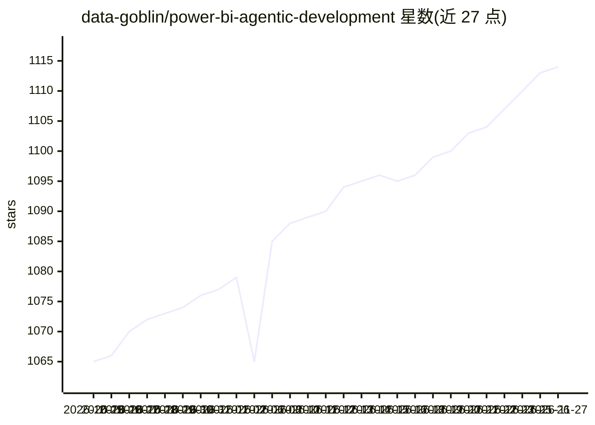

# data-goblin/power-bi-agentic-development

⭐ 1,114 · C# · GPL-3.0 · 推送 2026-11-25 · [GitHub](https://github.com/data-goblin/power-bi-agentic-development) · [官网](https://data-goblins.com) · 个人维护

**给 Claude Code/Copilot 装 Power BI 技能的插件市场**

一个 Anthropic 格式的插件市场仓库，收录面向 Power BI 与 Microsoft Fabric 的 skills、subagents 和 hooks，覆盖语义模型、DAX、TMDL、PBIR 项目文件与报表等主题。通过 `claude plugin marketplace add` 注册后按需安装子插件；Copilot CLI 读取同一 marketplace.json 清单，可不经修改直接使用。hooks 为确定性校验（DAX 引用、PBIR/TMDL 结构等），可经 config.yaml 逐项开关；仓库按周发布，26.26–26.38 为声明的不兼容过渡期，建议锁定 26.25 及更早版本。

## 筛选速览

| 维度 | 判定 | 备注 |
|---|---|---|
| AI 角色 | `ai-ecosystem` | LLM/agent 周边工具 |
| 许可风险 | `viral` | GPL-3.0 |
| 部署形态 | `None` |  |
| 模型依赖 | locked-api |  |
| 硬件要求 | — | 无带数字的原话,不猜 |
| 安装摩擦 | `low` | 无编译、无系统依赖或容器化 |
| 成熟度 | — | 结构信号不足 |

## 能力要点

- 以 Anthropic 格式插件市场分发 skills、subagents、hooks
- Copilot CLI 读取同一 marketplace.json，双扩展（*.agent.md/*.md）兼容两类工具
- 确定性 hooks 校验 DAX 引用、PBIR 结构、TMDL 语法，支持 config.yaml 逐项开关
- 声明每周发布节奏与 26.26–26.38 破坏性过渡区间

## 适用场景

- 让 Claude Code 或 Copilot CLI 学习 Power BI/Fabric 领域知识与工作流
- 校验 PBIP/TMDL/PBIR 项目文件的语法与命名规范
- 连接 Power BI Desktop 实时查询模型并捕获 DAX 查询
- 为 Tabular Editor 生成与调试 BPA 最佳实践规则

## 场景标签

`编码 Agent` `提示工程` · 领域:Agent 开发

## 证据(README 行号)

> L23: - A *marketplace* hosts *plugins* that you can install. Plugins are a collection of resources that help coding agen
> L24: - This marketplace is focused on everything to help your agent work well with Power BI and Fabric: Power BI skills,
> L31: claude plugin marketplace add data-goblin/power-bi-agentic-development

## 星数曲线

2026-10-25 1,065 → 2026-11-27 1,114（+49）

---
*卡片 v1 · prompt 1.4 · 生成 2026-11-24 · 置信度 high · 依据 README sha `a209e0817976` · [字段定义](../../DATASET.md)*
