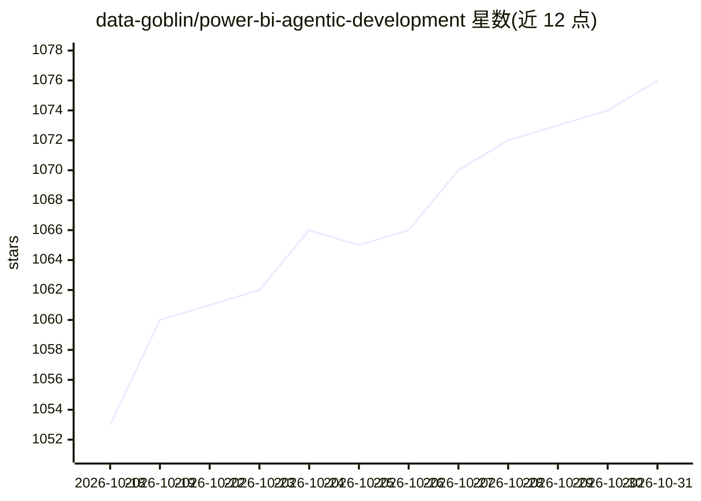

# data-goblin/power-bi-agentic-development

⭐ 1,076 · C# · GPL-3.0 · 推送 2026-10-30 · [GitHub](https://github.com/data-goblin/power-bi-agentic-development) · [官网](https://data-goblins.com) · 个人维护

**Power BI/Fabric 的 Claude Code 与 Copilot 插件市场：技能、子代理与钩子**

面向编码代理的 Anthropic 格式插件市场，收录 Power BI 与 Microsoft Fabric 相关的技能（skills）、子代理（subagents）和钩子（hooks），覆盖语义模型、DAX、TMDL、PBIR 报表文件、Tabular Editor 自动化与 Desktop Bridge 连接等任务。钩子提供确定性校验（DAX 引用、参照完整性、PBIR/TMDL 结构等），可经 config.yaml 逐项开关。每周发布，26.26–26.38 为破坏性过渡期。通过 claude/copilot plugin 命令安装，Copilot CLI >= 1.0.26。

## 筛选速览

| 维度 | 判定 | 备注 |
|---|---|---|
| AI 角色 | `ai-ecosystem` | LLM/agent 周边工具 |
| 许可风险 | `viral` | GPL-3.0 |
| 部署形态 | `None` |  |
| 模型依赖 | locked-api |  |
| 硬件要求 | — | 无带数字的原话,不猜 |
| 安装摩擦 | `low` | 无编译、无系统依赖或容器化 |
| 成熟度 | `idea` | |

## 能力要点

- 多个插件包：goblin-mode、tabular-editor、pbi-desktop、pbip、reports 等
- 钩子提供确定性文件校验（DAX 引用、参照完整性、PBIR/TMDL 结构）
- 同一 marketplace.json 清单同时适配 Claude Code 与 Copilot CLI
- 每周发布节奏，26.26–26.38 为明确的破坏性过渡区间

## 适用场景

- 让 Claude Code 或 Copilot CLI 掌握 Power BI 语义模型与 DAX 开发知识
- 自动校验 PBIP 项目中 TMDL/PBIR 文件的结构与绑定
- 通过代理自动审查 BPA 规则与报表文件

## 场景标签

`精选清单` · 领域:学习与行业

## 证据(README 行号)

> L23: - A *marketplace* hosts *plugins* that you can install. Plugins are a collection of resources that help coding agen
> L24: - This marketplace is focused on everything to help your agent work well with Power BI and Fabric: Power BI skills,
> L126: - **Skills** teach agents domain knowledge and workflows. They activate automatically based on task context, or ca

## 星数曲线

2026-10-18 1,053 → 2026-10-31 1,076（+23）

---
*卡片 v1 · prompt 1.4 · 生成 2026-10-21 · 置信度 high · 依据 README sha `d342aa4c583d` · [字段定义](../../DATASET.md)*
